# 衡鉴 · 团队分工架构

> **一句话结论**：项目按 **8 角色 × 4 阶段** 组织 —— 探索团队（业务建模）→ 架构团队（系统设计）
> → 构建团队（前后端实现）→ 集成团队（联调交付），Lead 只做编排不做主力实现；
> 每个角色都有明确交付物与验收门，交付物之间靠《项目事实基线》保持事实一致。

---

## 一、组织原则

本项目的团队模型来自 SDD（规范驱动开发）方法论的三条硬约束：

| # | 原则 | 本项目的落地方式 |
| --- | --- | --- |
| 1 | **Lead 只做编排，不做主力实现** | Lead 负责定角色、卡依赖、批计划、收结果；具体文档与代码由对应角色产出 |
| 2 | **规格先行** | 先出《项目事实基线》锁定全部数字与契约，再让各角色并行写作；下游文档不允许自造数字 |
| 3 | **门禁前置** | 每个阶段有明确交付物与验收门，不通过不进入下一阶段（映射到 CI 四道门禁） |

---

## 二、八角色职责与交付物

| # | 角色 | 职责 | 主要交付物 | 禁止事项 |
| --- | --- | --- | --- | --- |
| 1 | **团队负责人（Lead）** | 定角色、卡依赖、批计划、收结果；维护《项目事实基线》 | 项目事实基线、任务清单、会议纪要、交付文档总览、团队分工架构 | 不下场写主体文档与业务代码 |
| 2 | **市场团队** | 场景调研、竞品拆解、反方风险识别 | 合同审核场景调研、反方风险清单、竞品功能拆解报告、原始资产整理 | 不做技术选型；不写实现方案 |
| 3 | **FDE / 产品经理** | 业务规则收口、原型需求、前后端职责边界 | 业务问题建模文档、前端交互设计规范 | 不自主发散（收口文档必须严格基于上游输入） |
| 4 | **探索团队** | 核心业务链路建模、状态机设计、审核规则体系梳理 | 审核流程与状态设计、审核规则体系梳理（含黄金测试集与评测报告） | 不写代码；规则只出设计与判据，实现属构建团队 |
| 5 | **架构团队** | 智能体架构、规则引擎与工具链选型、服务边界划分、数据模型 | 系统架构设计文档、领域数据模型定义、服务边界与接口契约、LangChain HITL 架构 | 不写业务实现；接口只出契约，实现属构建团队 |
| 6 | **构建团队** | 前端交互落地、后端 FastAPI 服务、数据持久化、规则引擎实现 | 前后端工程代码骨架、API 接口规范文档、前端架构规范、后端实现计划 | 不擅自改契约；契约变更必须回写 `docs/08_api_spec/` |
| 7 | **集成团队** | 接口对齐验证、全链路联调、容器化与交付部署 | 集成联调计划、部署与运维规范、可交付运行产物、项目环境要求、设备手册 | 不伪造"已验证"；未实测的环境必须标注【未实测】 |
| 8 | **质量角色（横切）** | 性能 / 安全 / 边界并行扫描、坏链路扫描、验收对账 | 验收对照表、接口冒烟测试报告、评测回归报告 | 不问"是否通过"，只问"证据在哪" |

---

## 三、四阶段协作模型

```mermaid
flowchart LR
    subgraph P1["第一阶段 · 探索团队"]
        A1[业务场景梳理]
        A2[竞品策略拆解]
        A3[核心审核链路建模]
        A4[业务状态机设计]
    end
    subgraph P2["第二阶段 · 架构团队"]
        B1[智能体协作架构]
        B2[规则引擎与工具链选型]
        B3[数据流与服务边界划分]
    end
    subgraph P3["第三阶段 · 构建团队"]
        C1[前端交互原型落地]
        C2[后端 FastAPI 服务搭建]
        C3[数据持久化与接口规范]
    end
    subgraph P4["第四阶段 · 集成团队"]
        D1[接口对齐验证]
        D2[全链路联调]
        D3[容器化封装与交付部署]
    end
    P1 --> P2 --> P3 --> P4
    P1 -.- P2
```

| 阶段 | 负责角色 | 交付产出 | 进入下一阶段的验收门 |
| --- | --- | --- | --- |
| **一 · 探索** | 市场团队 + 探索团队 | 《业务问题建模文档》《竞品功能拆解报告》《审核流程与状态设计》 | 核心业务实体与关系定义完成；状态机五态确定；规则体系框架与判据类型确定 |
| **二 · 架构** | 架构团队 | 《系统架构设计文档》《领域数据模型定义》《服务边界与接口契约》 | 多智能体/模块拓扑与通信机制确定；实体关系与状态流转设计完成；接口契约冻结 |
| **三 · 构建** | 构建团队 | 《前后端工程代码骨架》《API 接口规范文档》《前端交互设计规范》 | 可运行的项目脚手架就位；RESTful 契约与数据结构与代码一致 |
| **四 · 集成** | 集成团队 + 质量角色 | 《集成联调计划》《部署与运维规范》《可交付运行产物》 | 联调顺序与验收标准明确；Docker 编排与环境配置可用；冒烟与评测全绿 |

**阶段间的信息契约**：每个阶段的产出是下一阶段的**输入**，
且所有数字必须来自《项目事实基线》。这条规则解决了多角色并行写作最容易出的问题 ——
**同一件事在五份文档里写出五个版本**。

---

## 四、任务依赖关系

| 任务 | 依赖 | 被依赖 |
| --- | --- | --- |
| 项目事实基线 | 无（最先产出） | 全部文档 |
| 业务问题建模文档 | 场景调研 + 竞品分析 | 审核流程设计、数据模型、前端交互规范 |
| 审核流程与状态设计 | 业务问题建模 | 数据模型（状态字段）、接口契约（状态门禁）、前端交互（状态文案） |
| 系统架构设计文档 | 业务建模 + 状态设计 | 数据模型、接口契约、工程代码骨架 |
| 领域数据模型定义 | 架构设计 + 状态设计 | 接口契约、后端实现 |
| 服务边界与接口契约 | 架构设计 + 数据模型 | API 规范、前后端实现、联调计划 |
| API 接口规范文档 | 接口契约 + 真实代码 | 联调计划、前端实现 |
| 前后端工程代码骨架 | 架构 + 数据模型 + 契约 | 联调计划、部署规范 |
| 集成联调计划 | 全部实现类文档 | 验收对照表 |
| 验收对照表 | 全部交付物 + 实测结果 | 交付总览 |

**关键依赖链**：`事实基线 → 业务建模 → 状态设计 → 数据模型 → 接口契约 → 代码 → 联调 → 验收`。
任一环变更，下游全部需要复核 —— 这就是为什么契约（接口与数据模型）要**先冻结再实现**。

---

## 五、质量门与角色对应

| 门禁 | 执行者 | 判据 | 对应 CI 作业 |
| --- | --- | --- | --- |
| 门禁一 · 静态检查 | 质量角色 | Ruff（E/F/W）+ 规则库 YAML 合法（ID 唯一、数量 ≥30、判定类型白名单）+ 示范条款交叉引用完整 | `lint` |
| 门禁二 · 单元测试 | 构建团队 | `pytest` 39 项全过 | `test` |
| 门禁三 · 回归跑分 | 探索团队 + 质量角色 | 高风险召回 = 100%、误报 = 0、解析成功率 = 100% | `eval` |
| 门禁四 · 镜像构建 | 集成团队 | `docker build` 成功 + 容器健康检查通过 | `build` |

**门禁三是本项目最有特色的一道**：规则库改动导致命中率退化会**直接把流水线打红**。
这让"规则即代码"从口号变成了机制。

---

## 六、协作规范（写入 `CLAUDE.md`）

| 规范 | 内容 |
| --- | --- |
| 目录职责 | `backend/` 只放后端；`frontend/` 只放前端（禁止 CDN 与构建工具）；`docs/` 按阶段编号；`deploy/` 只放部署配置 |
| 环境统一 | 依赖用 uv 管理；配置走 `.env`；禁止把密钥入库 |
| 阶段产出 | 每个阶段必须有明确输出文件；复杂任务先出计划再实施 |
| 契约唯一 | 接口与数据模型以 `app/schemas.py` + `docs/` 为准，口头约定无效 |
| 高风险操作 | 删除/覆盖样例合同、改规则 ID、`git push --force`、批量重命名 —— 一律先警告、列清单、等确认 |
| 未实现标注 | 凡未实现的能力必须显式标注 **【未开发】**，禁止伪造功能 |

---

## 七、分工与交付物对照总表

| 交付物 | 责任角色 | 文档路径 |
| --- | --- | --- |
| 项目事实基线 | 团队负责人 | `docs/00_setup/项目事实基线.md` |
| 团队分工架构 · 任务清单 · 交付文档总览 | 团队负责人 | `docs/00_setup/` |
| 原始资产整理 | 市场团队 | `docs/00_setup/原始资产整理.md` |
| 业务问题建模文档 · 竞品功能拆解报告 | 市场团队 + FDE | `docs/03_problem_modeling/` `docs/02_competitor_analysis/` |
| 审核流程与状态设计 | 探索团队 | `docs/04_interaction_design/` |
| 审核规则体系梳理（含黄金测试集与评测报告） | 探索团队 | `docs/07_data_model/审核规则体系梳理.md` |
| 系统架构设计文档 · LangChain HITL 架构 | 架构团队 | `docs/06_architecture_design/` |
| 领域数据模型定义 | 架构团队 | `docs/07_data_model/` |
| 服务边界与接口契约 · API 接口规范文档 | 架构 + 构建团队 | `docs/08_api_spec/` |
| 前后端工程代码骨架 · 前端架构规范 · 后端实现计划 | 构建团队 | `docs/09_frontend_plan/` `docs/10_backend_plan/` |
| 前端交互设计规范 | FDE | `docs/05_prototype/前端交互设计规范.md` |
| 技术方案 | 团队负责人 + 架构团队 | `docs/06_architecture_design/技术方案.md` |
| 集成联调计划 | 集成团队 | `docs/11_integration/集成联调计划.md` |
| 部署与运维规范 · 项目环境要求 | 集成团队 | `docs/12_release_deployment/` |
| 可交付运行产物 · 设备手册 · 演示脚本 | 集成团队 | `docs/13_delivery/` |
| 验收对照表 · 接口冒烟测试报告 | 质量角色 | `docs/13_delivery/` |
| 会议纪要（第三次 / 第四次） | 团队负责人 | `docs/13_delivery/` |
| 全流程架构图 | 团队负责人 + 集成团队 | `docs/13_delivery/全流程架构图.html` |
| 可运行系统（代码） | 构建团队 | `backend/` `frontend/` |

---

## 相关文档

- `docs/00_setup/任务清单.md` —— 逐项任务与状态
- `docs/13_delivery/会议纪要-第三次.md` · `docs/13_delivery/会议纪要-第四次-项目结项交付.md` —— 分工与决议的形成过程
- `docs/00_setup/项目事实基线.md` —— 全角色共享的事实来源
- `CLAUDE.md` —— 协作规范与工程红线
