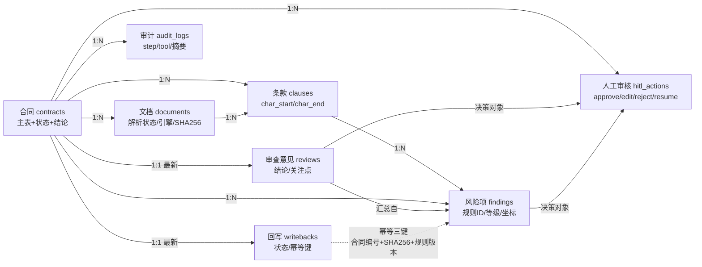

# 衡鉴 2.0 · 业务问题建模文档

> **一句话结论**：衡鉴解决的是"合同审批前，法务/业务方看不完、看不准、说不清合同风险"的问题——用确定性规则引擎 + 大模型解释，把风险定位到原文字符级、给出可采纳的修改建议，并只把意见写回审批单评论区，不碰审批结论。

---

## 一、核心业务问题

**合同风险审查的本质矛盾**：审批流程要求"每单必审"，但合同数量大、篇幅长、风险点散、专业门槛高，人工逐字审既不可持续也容易漏判。

用一个句子概括：**让每一份合同在审批前先过一遍"数字法务"的脑子——风险可定位、依据可追溯、意见可回写。**

### 三个真实痛点（附量级）

| 痛点 | 业务语言描述 | 量级 / 可观测现象 | 为什么痛 |
| --- | --- | --- | --- |
| **看不完** | 一份合同动辄十几页、数千字，逐条核对条款耗时且容易疲劳跳读 | 演示样例含 4 页 / 1245 字 / 10 个条款节点（样例 01）；13 份样例平均篇幅可观 | 审批时效考核下，法务被迫"翻而不审"，形式化通过 |
| **看不准** | 同一句话在不同业务视角下风险相反（如"IP 归甲方"在采购有益、在销售有害），靠关键词匹配必然误报漏报 | 规则库 32 条、11 条高风险，需按 4 类业务（采购/销售/服务/劳动）做视角实例化 | 误报会淹没真风险、漏报会放过真雷；不可信的系统没人敢用 |
| **说不清** | 即便发现了问题，也缺少"定位 + 依据 + 建议"三位一体的表达，结论难以被审批人与相对方采信 | 每条风险需带 `[char_start, char_end)` 字符区间 + 页码 + 段落 + 法条依据 + 修改建议 | 没有证据链的意见只是主观判断，无法在审批流中流转与复核 |

> 量级说明：以上数字来自项目事实基线第八章的真实运行数据；演示样例的合同规模用于说明"单份体量"，并非全企业年审体量测算。

---

## 二、目标用户（三类角色）

| 角色 | 职责 | 使用频次 | 核心诉求 | 成功标准 |
| --- | --- | --- | --- | --- |
| **送审业务方**（申请人 / 部门） | 发起合同审批、补充合同背景 | 中频（按业务节奏） | 上传即可拿到一份"风险地图"，知道自己这份合同哪里危险、要不要先改 | 上传后无需催问，系统已给出定位清晰的风险清单 |
| **审查法务**（核心用户） | 确认系统结论、改判等级、改写建议、决定是否回写 | 高频（审批关卡） | 双栏联动快速核对"风险点 ↔ 原文"，可一键采纳/改写建议，驳回错误结论 | 高风险召回不漏（≥100% 基线）、误报不干扰、回写评论一次成功 |
| **合规 / 规则维护者** | 维护规则库与示范条款、跑回归评测 | 低频（规则变更时） | 看到每条规则的命中逻辑与版本，改完能立刻跑黄金样例验证不退化的 | 规则改动能被回归评测门禁兜住（高风险召回 <100% 即失败） |

**明确不做**：审批人（拍板通过/拒绝的人）不是本系统的目标用户——系统只写评论区，不提供任何改变审批结论的动作。

---

## 三、MVP 业务场景（选 2 个）

### 场景一：软件采购合同的知识产权与付款风险审查

| 项 | 内容 |
| --- | --- |
| **触发条件** | 采购类（含软件开发/外包）合同上传，业务类型识别为"采购/服务" |
| **参与者** | 送审业务方（上传）→ 审查法务（确认/改判）→ 系统（回写评论） |
| **主流程** | 上传 DOCX/PDF → 解析切条 → 规则引擎按"采购视角"实例化 → 命中 IP 归属、付款无验收前置、预付款过高等规则 → 法务双栏核对 → 采纳/改写建议 → 回写审批单评论区 |
| **输出物** | 带字符级定位的风险清单（IP 归属相对方、付款缺验收、预付款≥50% 等）、修改建议、可写回的评论正文 |
| **基线佐证** | 演示样例 01《软件采购合同_埋雷版》埋 6 条高风险，命中 HJ-H-001/HJ-H-002/HJ-H-003/HJ-H-004/HJ-H-007/HJ-H-008 |

**为什么选它**：知识产权与付款是采购合同最高发的"看不准"场景——"IP 归甲方"在采购中对我方有利，规则必须用 `{我方}/{对方}` 占位做视角实例化，最能体现系统壁垒。

### 场景二：大额销售合同的违约责任不对等审查

| 项 | 内容 |
| --- | --- |
| **触发条件** | 销售类合同上传，业务类型识别为"销售"，金额较大 |
| **参与者** | 送审业务方（上传）→ 审查法务（确认/改判）→ 系统（回写评论） |
| **主流程** | 上传 DOCX → 解析切条 → 规则引擎按"销售视角"实例化（我方=乙方）→ `imbalance_regex` 判定同一方在 N 字符内被加重/减轻 → 命中违约责任严重不对等 → 法务核对 → 回写 |
| **输出物** | 不对等条款的字符级定位、权责对比说明、改写建议 |
| **基线佐证** | 演示样例 05《大额销售合同_埋雷版》埋 3 条高风险，销售视角下 `imbalance_regex` 防误报 |

**为什么选它**：销售合同是"视角反转"的典型——采购视角下的安全条款，在销售视角下变成对我方不利的雷。能直接验证"脱离视角必误报"的设计假设是否被工程化解。

---

## 四、问题边界定义

### 做什么（In Scope）

- 解析 DOCX / PDF / 扫描件（PNG·JPG 等），统一到 `full_text` 字符坐标系
- 确定性规则引擎判定风险等级与依据（32 条规则、8 种判定类型）
- 大模型负责解释成因、润色建议、检测跨条款矛盾（失败即降级，不阻断）
- 原文高亮定位、风险卡片、采纳/改写建议
- 把审查意见作为**评论**写回审批单（DRY_RUN 预览 + 幂等）

### 不做什么（Out of Scope，工程红线）

| 边界 | 说明 | 依据 |
| --- | --- | --- |
| **不做审批决策** | 不提供通过 / 拒绝 / 转交 / 撤回等任何改变审批结论的动作 | 基线第九章：后端不存在任何审批结论写操作接口 |
| **不做合同起草** | 不生成完整合同，只给出"修改建议"片段供法务采纳 | 系统产出 `advice` 文本，非整稿 |
| **不做法律意见书** | 输出是"风险清单 + 建议"，不构成正式法律意见 | 设计为辅助审查工具，非法律意见出具方 |
| **不替代法务** | 系统结论是"待确认"状态，必须由审查法务 approve / edit / reject | HITL 中断点 + 门禁设计 |
| **不跨格式差异化高亮** | 三种来源共用一套字符区间高亮逻辑，不引入 pdf.js 文本层 | 基线第三章：统一坐标系是壁垒 |

---

## 五、业务实体与关系

> 八个核心实体（对应 SQLite 表）：合同 `contracts`、文档 `documents`、条款 `clauses`、风险项 `findings`、审查意见 `reviews`、回写 `writebacks`、审计 `audit_logs`、人工审核 `hitl_actions`。

**关系要点（为什么这样连）**

- 条款与文档都挂在合同下，但条款的坐标锚定在 `full_text`，文档只记录"怎么解析出来的"——二者解耦，重试时清条款不清文档指纹。
- 风险项同时引用合同与条款，但 `clause_id` 可空：扫描件/OCR 路径下可能只落到字符区间，不强制绑定条款节点。
- 回写与风险项通过"幂等三键"间接关联（合同编号 + 附件 SHA256 + 规则版本号），保证"同样一份合同用同一版规则"的结果可复用、可跳过。
- HITL 落"动作流水"而非"状态字段"：谁在何时同意/修改/驳回了什么天然可追溯，**审计信息即业务数据**，无需额外状态迁移日志。

---

## 相关文档

- `../00_setup/项目事实基线.md` —— 唯一事实来源（数字、接口、状态机、阻塞码）
- `02_需求与范围/`（需求与范围文档）—— 功能范围与优先级
- `../04_interaction_design/审核流程与状态设计.md` —— 全链路时序与状态机
- `../04_interaction_design/01_上传与解析链路.md` —— 上传与解析交互细节
- `../05_prototype/前端交互设计规范.md` —— 双栏联动与高亮实现
