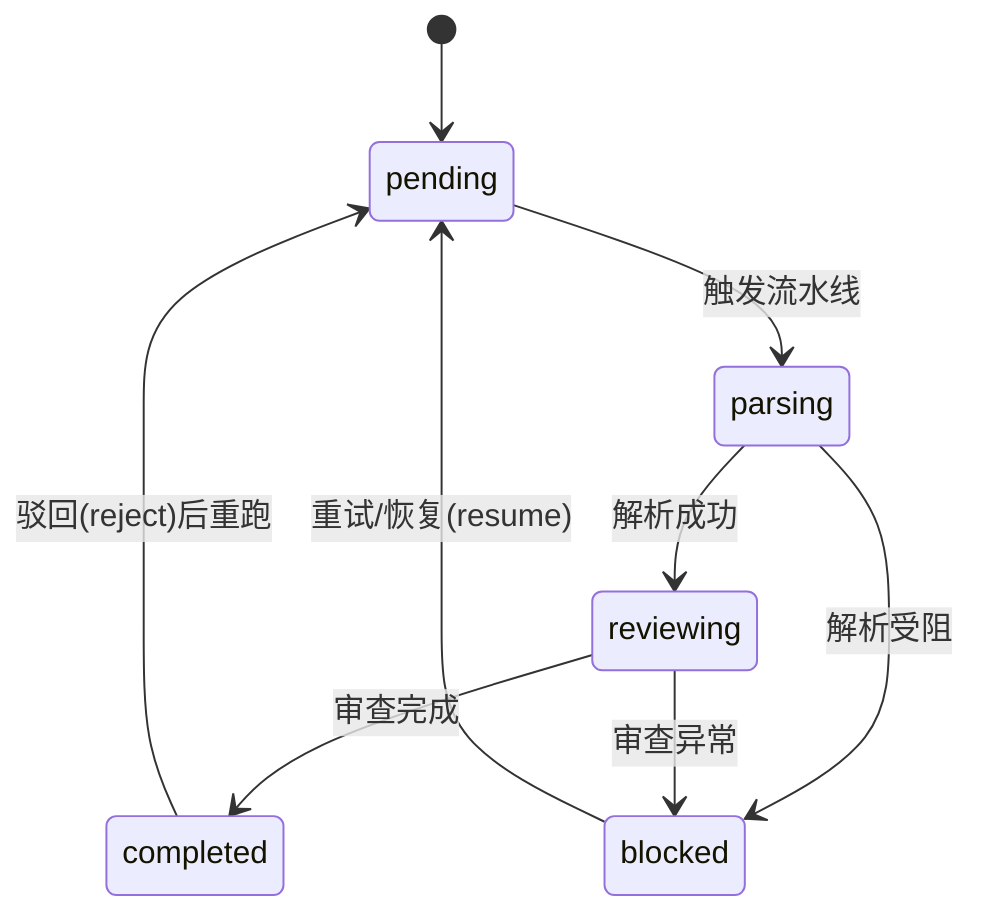
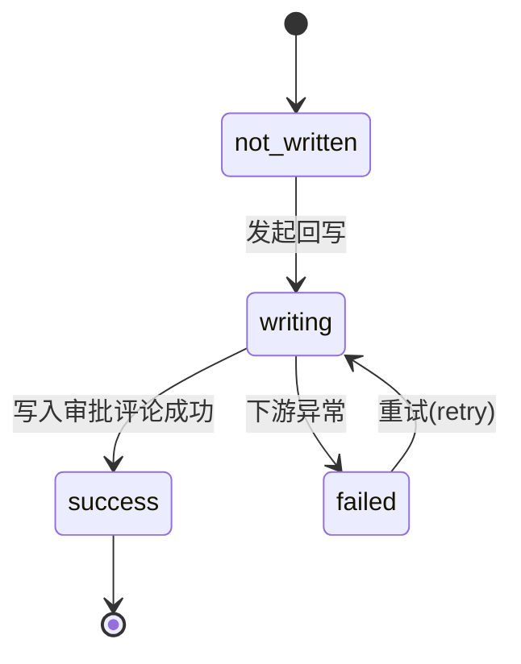

# 衡鉴 2.0 · 中间状态与异常（交互设计）

> **一句话结论**：任务有 5 态（pending/parsing/reviewing/blocked/completed）、回写有 4 态（not_written/writing/success/failed）；六种阻塞码各自带可读文案与处理建议，SSE 把进度推给前端；LLM/OCR 不可用时**显式降级**，不让用户看到"假正常"。

---

## 一、任务状态机（5 态）



| 状态 | 业务含义 | 前端展示 |
| --- | --- | --- |
| `pending` | 已建任务，未开始解析 | 状态标签"待处理"；大盘进度条 4% |
| `parsing` | 解析中 | 标签"解析中"（蓝）；进度条约 10–50%，SSE 实时推进 |
| `reviewing` | 规则引擎 + 语义增强中 | 标签"审查中"（黄）；进度约 58–84% |
| `blocked` | 解析/审查受阻，需人工 | 标签"解析受阻"（红）；展示阻塞 banner + 重试按钮 |
| `completed` | 审查完成，待人工确认 | 标签"审查完成"（绿）；可进入 HITL 与回写 |

**为什么 blocked 单独成态**：解析失败若带着空正文去跑规则引擎，会产出"看起来正常其实全错"的审查意见——危害大于直接报错。因此 blocked 在 parsing 阶段就分流，不进入 reviewing。

---

## 二、回写状态机（4 态）



| 状态 | 含义 | 前端展示 |
| --- | --- | --- |
| `not_written` | 尚未回写（含 DRY_RUN 预览） | 标签"未回写"；展示幂等键与评论 ID 占位 |
| `writing` | 回写进行中 | "回写中"；写回按钮进入 loading |
| `success` | 已写入审批单评论区 | 标签"回写成功"（绿）；展示实际 `platform_comment_id` |
| `failed` | 回写失败，保留错误 | 标签"回写失败"（红）；展示 `error` 并出现"重试回写"按钮 |

---

## 三、六种阻塞代码（逐条）

> 阻塞信息落在 `contracts.block_code` 与 `contracts.block_reason`，文档级原因落在 `documents.block_reason`。前端 `renderBlocked` 统一用红色 banner 展示 `block_reason` + 一句通用处理建议；下方按码拆开说明。

| 代码 | 触发条件 | 用户看到的文案（block_reason 示例） | 处理建议 | 前端应展示什么 |
| --- | --- | --- | --- | --- |
| `DOC_ENCRYPTED` | PDF 需密码，解析器抛 `PdfEncrypted` | "PDF 需要密码，无法解析" | 上传去除密码的版本 | 阻塞 banner + "重新解析/重试"按钮；提示"加密文档请去除密码后重新上传" |
| `OCR_ENGINE_UNAVAILABLE` | 扫描件（image）但 RapidOCR 未安装 | "OCR 引擎不可用：…" | 安装 `rapidocr-onnxruntime` | 阻塞 banner + 重试按钮；提示"OCR 引擎缺失请安装 rapidocr-onnxruntime" |
| `OCR_LOW_CONFIDENCE` | 平均 OCR 置信度 < `OCR_BLOCK_THRESHOLD`(0.35) | "OCR 平均置信度过低（<0.35）" | 重新上传清晰扫描件 | 阻塞 banner + 重试；提示"扫描件请提供更清晰的版本" |
| `EMPTY_CONTENT` | 解析后正文 < `MIN_TEXT_CHARS`(120) 字 | "正文内容过少（<120 字）" | 检查文档是否为纯图片无文字层 | 阻塞 banner + 重试；提示"可能为纯图片 PDF/空文档" |
| `PARSE_FAILED` | 解析器抛未预期异常（非加密/非 OCR 缺） | "解析失败：{具体异常}" | 查看审计日志定位 | 阻塞 banner + 重试；建议"查看审计日志定位" |
| `PIPELINE_ERROR` | 流水线未预期异常且未落入 blocked | "流水线异常：{具体异常}" | 查看 `audit_logs.detail` | 阻塞 banner + 重试；异常细节在审计日志 |

**设计要点（来自基线）**："引擎缺失"与"图片模糊"必须分开记录——前者是环境缺依赖，重试无意义；后者是素材质量问题，换文件才解决。混为一谈会导致重试永远失败。

### 前端阻塞态统一文案（代码实写）

```
任务已阻塞（需人工处理）
{block_reason}
处理建议：加密文档请去除密码后重新上传；扫描件请提供更清晰的版本；
          OCR 引擎缺失请安装 rapidocr-onnxruntime。
[ 重新解析 / 重试 ]
```

重试调用 `POST /{id}/retry?wait=false`，后端清空历史 clauses/findings/reviews 后重跑，回写记录保留、幂等键不变。

---

## 四、SSE 进度事件的前端消费

### 4.1 事件格式

`GET /{id}/events?from_seq=0`，服务端按 `text/event-stream` 推送：

```json
{
  "seq": 3, "contract_id": 17, "stage": "parsing",
  "message": "DOCX 段落树解析完成（12 段）",
  "progress": 35, "level": "info", "ts": "11:02:05", "extra": {}
}
```

- `stage`：`parsing / reviewing / completed / blocked / error / idempotent` 等
- `progress`：0–100，直接驱动进度条
- `level`：`info / warn / error`，决定时间轴节点颜色
- 默认 `idle_limit=150`（×0.1s ≈ 15 秒无新事件即结束连接），期间每 50 次心跳发 `: keep-alive`

### 4.2 前端消费方式（已实现）

- 用 `EventSource` 订阅 `/{id}/events`；`onmessage` 解析 JSON 并回调。
- 监听 `end` 事件与 `onerror` 即 `es.close()`，避免悬挂连接。
- 当 `stage ∈ {completed, blocked, error}` 时关闭流，延迟 400ms 重新拉取详情 (`loadAll`)。
- 大盘 `selectTask` 与工作台 `watch()` 都对 `pending/parsing/reviewing` 态自动订阅，并在终态后刷新列表与统计。
- 进度条映射：`pending 4% / parsing 30% / reviewing 70% / blocked·completed 100%`，但 SSE 的 `progress` 字段会实时覆盖（如 parsing 10→35→50）。

**为什么用 SSE 而非轮询**：不必轮询、也不会"卡住了不知道卡在哪"——每个阶段都点亮，符合"进度可观测"的设计目标。

---

## 五、降级策略（LLM / OCR 不可用，体验不失真）

| 降级场景 | 触发 | 系统行为 | 用户看到的（不失真） |
| --- | --- | --- | --- |
| **LLM 不可用** | `HJ_LLM_ENABLED=false` 或超时/返回非法 JSON（`LLM_TIMEOUT` 默认 8s） | 规则引擎照常判定；LLM 层降级到模板生成器，`enriched.used_llm=False` | 顶部健康灯"语义层：降级模板"（橙）；SSE 推 `warn` 事件"大模型未启用/不可用，已降级模板生成器"；风险结论照常、建议来自标准条款库 |
| **OCR 引擎缺失（扫描件）** | 扫描件且 RapidOCR 未安装 | 解析阶段抛 `OcrUnavailable` → 落 `OCR_ENGINE_UNAVAILABLE` 阻塞 | 明确进入 blocked 态，提示安装依赖；**绝不**假装解析成功 |
| **OCR 置信度过低** | 平均置信度 < 0.35 | 落 `OCR_LOW_CONFIDENCE` 阻塞 | 提示换清晰扫描件 |
| **PDF 文本层缺失（图片型）** | PDF 无文本层 | 回退 OCR；若 OCR 不可用则阻塞，可用则照常 | 可见的"已对 N 页执行 OCR"进度，而非静默失败 |
| **DOCX/PDF 文本层** | —— | 不依赖 OCR，正常解析 | 不受影响 |

**降级原则**：任何外部依赖失效都**显式暴露给用户**，要么走阻塞态、要么走"降级模板"标识，绝不产出"看起来正常其实没增强/没解析"的假结果——这是对"看不准"痛点的工程化兜底。

---

## 相关文档

- `01_上传与解析链路.md` —— 上传校验、幂等、30MB 上限
- `03_人工审核链路.md` —— blocked 态的 resume 与 HITL
- `审核流程与状态设计.md` —— 状态迁移表与重试策略
- `../00_setup/项目事实基线.md` —— 阻塞码、状态机、SSE 约定
