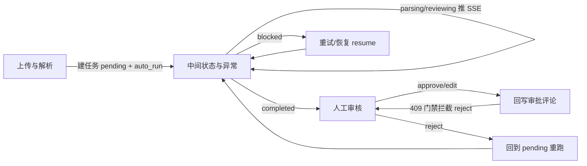

# 衡鉴 2.0 · 交互设计三条链路收口汇总

> **一句话结论**：三条链路（上传与解析 → 中间状态与异常 → 人工审核）共同构成"上传即审、异常显式、结论人确认"的闭环；本文是三份细节文档的收口，给出每张图的衔接点与必须守住的红线。

---

## 一、三条链路一句话定位

| 链路 | 文档 | 一句话 | 关键不变量 |
| --- | --- | --- | --- |
| **上传与解析** | `01_上传与解析链路.md` | 30MB 上限、SHA256 幂等去重、建任务即跑流水线 | 同一文件不重复建任务、不重复解析 |
| **中间状态与异常** | `02_中间状态与异常.md` | 5 态 + 4 态 + 6 阻塞码 + SSE + 降级 | 外部依赖失效必须显式暴露，不许"假正常" |
| **人工审核** | `03_人工审核链路.md` | approve/edit/reject/resume + 409 门禁 | 被驳回的结论禁止回写，必须重跑 |

---

## 二、链路衔接点

- 上传链路的 `auto_run` 直接把任务推入中间状态链路的 `pending→parsing→reviewing`。
- 中间状态链路的 `completed` 是人工审核链路唯一的"可确认"入口。
- 人工审核链路的 `reject` 把任务踢回中间状态链路（回到 `pending` 重跑），形成闭环。
- 回写（在 `审核流程与状态设计.md` 详述）受 409 门禁约束，其权威状态来自 `GET /{id}/hitl` 的 `writeback_allowed`。

---

## 三、必须守住的红线（跨链路一致性）

1. **幂等三键不破**：合同编号 + 附件 SHA256 + 规则版本号。任何"重新跑"都必须保证同键复用、不重复回写。
2. **阻塞先于审查**：解析失败必须进 `blocked`，绝不能带着空正文跑规则引擎。
3. **降级显式化**：LLM/OCR 不可用 → 要么标"降级模板"、要么进阻塞，绝不出"假正常"结论。
4. **结论人拍板**：只有 `completed` 态能 `approve/edit/reject`；`reject` 后回写必被 409 拦。
5. **只写评论不改结论**：回写只落 `platform_comments`，后端无审批结论写接口。

---

## 四、状态/错误码速查

| 上下文 | 状态码/码 | 用户语义 |
| --- | --- | --- |
| 上传类型错 | 400 | 不支持的文件类型 |
| 上传超限 | 413 | 超过 30MB |
| HITL 非法动作 | 400 | 不支持的审核动作 |
| HITL 编辑无清单 | 400 | edit 必须提供 edits |
| HITL 非 completed | 409 | 无可确认/驳回的审查结果 |
| 回写非 completed | 409 | 任务尚未审查完成 |
| 回写被驳回 | 409 | 审查结果已被驳回，请重新发起审查 |
| 阻塞码 | 6 种 | 见 `02` 文档逐条表 |

---

## 相关文档

- `01_上传与解析链路.md` / `02_中间状态与异常.md` / `03_人工审核链路.md` —— 三份细节
- `审核流程与状态设计.md` —— 全链路时序图、状态机图、迁移表
- `../05_prototype/前端交互设计规范.md` —— 前端落地
- `../00_setup/项目事实基线.md` —— 事实唯一来源
