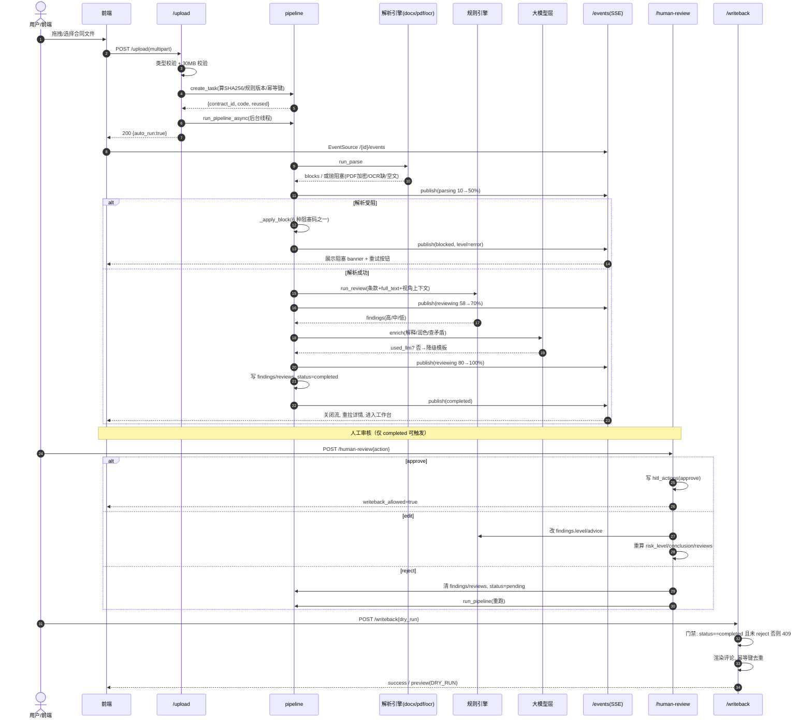
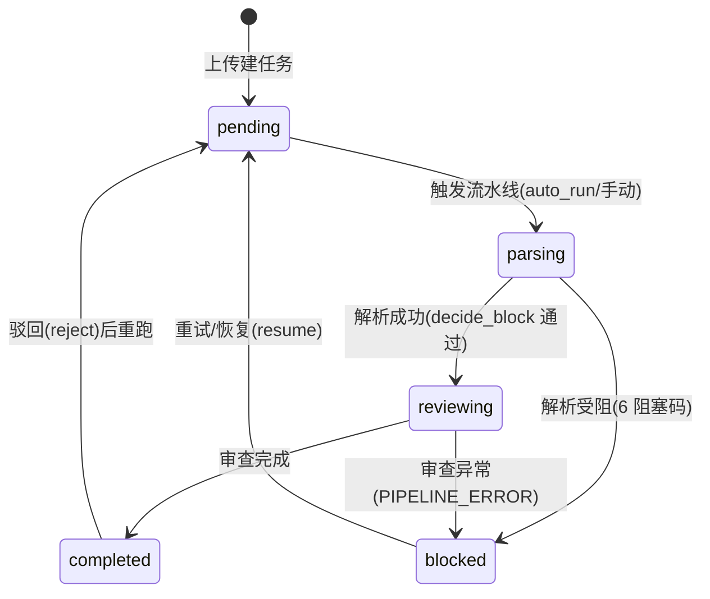
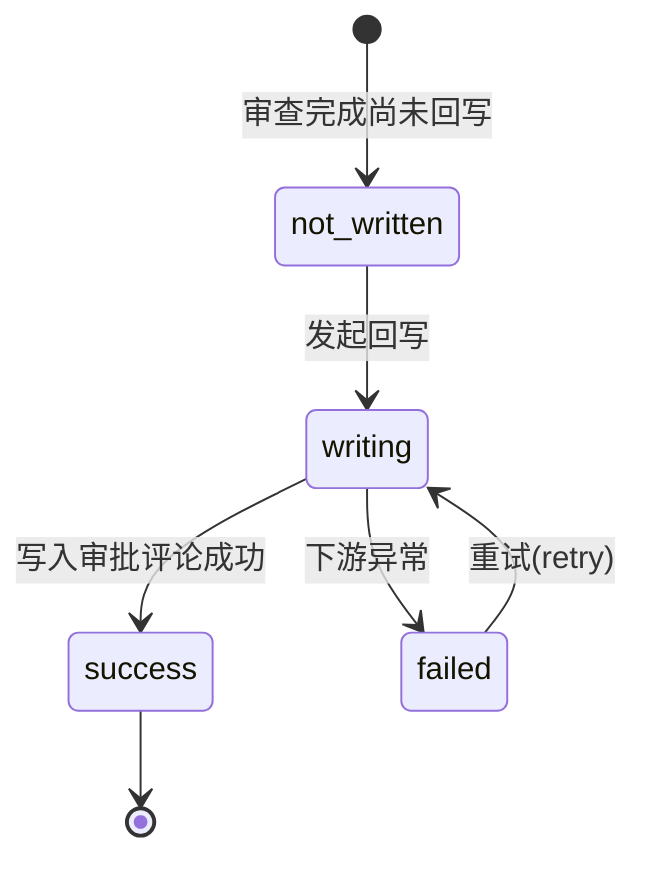

# 衡鉴 2.0 · 审核流程与状态设计（正式交付物）

> **一句话结论**：系统以"上传→解析→审查→人工审核→回写"五段式流水线串起全链路，用任务 5 态 + 回写 4 态表达生命周期，用六阻塞码与 409 门禁把异常和越权挡在接口层，所有步骤经 `audit_logs` 闭环可追溯。

---

## 一、全链路时序图



> 时序图要点：**阻塞分支在解析阶段就切出**，不进入审查；**人工审核是 completed 之后的可选确认**，且 reject 会把任务踢回 `pending` 重跑；**回写受 409 门禁**，被驳回或未完成都写不进去。

---

## 二、状态机图

### 2.1 任务状态机（5 态）



### 2.2 回写状态机（4 态）



---

## 三、状态迁移表

### 3.1 任务状态迁移

| 当前态 | 事件 | 下一态 | 副作用 | 失败处理 |
| --- | --- | --- | --- | --- |
| `pending` | 触发流水线 | `parsing` | 清 `block_code/block_reason` | 异常→`blocked`(PIPELINE_ERROR) |
| `parsing` | 解析成功 | `reviewing` | 写 clauses/documents(parse_status=success) | — |
| `parsing` | 解析受阻 | `blocked` | `_apply_block` 写阻塞码 + 审计 | 已落 blocked，等重试 |
| `reviewing` | 审查完成 | `completed` | 写 findings/reviews，`risk_level/conclusion` | — |
| `reviewing` | 审查异常 | `blocked` | `PIPELINE_ERROR` + 审计 | 等重试 |
| `blocked` | 重试/恢复(resume) | `pending` | 清 clauses/findings/reviews，回写保留 | 重跑可能再次 blocked |
| `completed` | approve/edit | `completed` | 写 hitl_actions；edit 重算等级/结论 | 409 若非 completed |
| `completed` | reject | `pending` | 清 findings/reviews，重跑流水线 | 重跑可能再次 blocked |

### 3.2 回写状态迁移

| 当前态 | 事件 | 下一态 | 副作用 | 失败处理 |
| --- | --- | --- | --- | --- |
| `not_written` | 发起回写 | `writing` | 渲染评论正文，记 idem_key | 下游异常→`failed` |
| `writing` | 写入成功 | `success` | 写 `platform_comments`，记 `platform_comment_id` | — |
| `writing` | 下游异常 | `failed` | 记 `error`，保留重试入口 | 用户点"重试回写" |
| `failed` | 重试(retry) | `writing` | 重新外发 | 再失败仍 `failed` |

### 3.3 异常码汇总

| 层级 | 码/状态 | 触发 | 处理 |
| --- | --- | --- | --- |
| 任务 | `blocked` + 6 阻塞码 | 加密/ OCR 缺/置信度低/空文/解析异常/流水线异常 | 显式 banner + 重试 |
| 回写 | `failed` | 外发异常 | 记错误 + 重试入口 |
| 接口 | 400 | 类型错/缺文件名/非法 HITL 动作/edit 无清单 | 红 toast |
| 接口 | 413 | 超 30MB | 红 toast 引导压缩 |
| 接口 | 409 | 回写非 completed / 被 reject / HITL 非 completed | 引导先完成审查或重跑 |

---

## 四、异常与重试策略

### 4.1 解析级重试（幂等、清脏）

- 入口：`POST /{id}/retry` 或 HITL `resume`。
- 行为：删 `clauses/findings/reviews`、`documents.parse_status=pending`，状态回 `pending`，**保留 `writebacks` 与幂等键**。
- 为什么清三表而不清回写：重试是"重新审查"，审查产物应重置；回写依赖幂等键，键不变则重复回写会被跳过，无需重置。

### 4.2 回写级重试

- 入口：`POST /{id}/writeback/retry`。
- 行为：仅重发既有评论正文；若幂等键已存在且已 `success`，后端返回既有结果并记 `writeback.skip`，不产生第二条评论。

### 4.3 大模型降级（不重试，直接兜）

- LLM 超时（`HJ_LLM_TIMEOUT` 默认 8s）/ 未配置 / 返回非法 JSON → 自动降级模板生成器，审查不中断，SSE 推 `warn` 事件。
- **设计取舍**：LLM 是"增强"不是"判定"，判定权在规则引擎，因此降级无需重试即可保真。

### 4.4 OCR 不可用（不重试，转阻塞）

- 扫描件 + OCR 引擎缺 → 落 `OCR_ENGINE_UNAVAILABLE` 阻塞；重试无意义（环境缺依赖），引导装包。
- 置信度低 → 落 `OCR_LOW_CONFIDENCE`，引导换素材。

### 4.5 全局兜底

- 流水线任何未预期异常被 `run_pipeline` 捕获 → 落 `PIPELINE_ERROR` + `audit_logs.pipeline.error`，不向外抛栈，前端看到的是明确的 blocked 态而非白屏。

---

## 五、审计闭环

每个关键步骤写 `audit_logs`（step / tool / input_digest / output_digest / cost_ms / detail），可从审查意见一路反查到：

```
task.create → parse.done / parse.blocked → review.done → hitl.{action} → writeback.write / writeback.skip
```

`hitl_actions` 与 `audit_logs` 分工：**前者记业务决策（谁同意/改/驳了什么），后者记系统执行（哪一步、用了什么工具、耗时多少）**。二者叠加即完整证据链。

---

## 相关文档

- `01_上传与解析链路.md` / `02_中间状态与异常.md` / `03_人工审核链路.md` —— 三段细节
- `interaction_design_summary.md` —— 三条链路收口
- `../05_prototype/前端交互设计规范.md` —— 前端落地
- `../03_problem_modeling/业务问题建模文档.md` —— 业务边界（只写意见不改结论）
- `../00_setup/项目事实基线.md` —— 状态机、阻塞码、接口唯一来源
