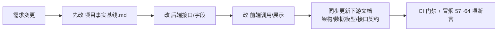

# 衡鉴 2.0 前后端职责边界（frontend_backend_boundary_spec）

> **一句话结论**：后端是「唯一的事实与判定源」——所有风险等级、字符坐标、幂等、状态流转都由后端产出；前端只负责**展示后端给的数据**与**发起约定好的操作**，严禁在前端做任何会动摇审查结论正确性的计算。

本文已对照 `api/contracts.py`、`api/rules.py`、`common.js`、各页 JS 核对。

---

## 1. 后端提供展示的数据（含字段清单）

前端展示所需字段**全部由后端接口直接返回**，前端不做二次派生（除纯 UI 格式化如 `money()`/`dt()`）：

| 页面/组件 | 后端接口 | 后端提供的关键字段 |
| --- | --- | --- |
| 大盘列表 | `GET /contracts` | id, code, name, biz_type, amount, currency, status, risk_level, conclusion, high_cnt/medium_cnt/low_cnt, file_type, created_at |
| 大盘指标 | `GET /stats/overview` | total, completed, blocked, parse_success_rate, findings, high_findings, avg_parse_ms, by_status, by_risk, by_writeback |
| 任务详情 | `GET /{id}` | task / document(meta) / clauses(char_start/char_end) / profile / review / writeback |
| 文档视窗 | `GET /{id}/document` | paragraphs[]{page, para_index, char_start, char_end, text, clause_type} |
| 风险卡片 | `GET /{id}/findings` | id, rule_id, title, level, clause_type, evidence_text, page, char_start, char_end, reason, legal_basis, advice, advice_source, adopted |
| 审查结论 | `GET /{id}/review` | risk_summary, conclusion, focus_points, high/medium/low_cnt, generated_by |
| HITL | `GET /{id}/hitl` | interrupt_at, interrupt_reason, status, available_actions, history |
| 回写 | `GET /{id}/writeback/preview` | preview, idem_key, writeback{status, platform_comment_id} |
| 规则树 | `GET /rules/tree` | clause_type, label, rules[]{id,title,level,type,reason,legal_basis} |
| 评测 | `GET /eval/score` | high_recall, false_positive, precision, parse_ok, avg_ms, verdict, cases[] |

---

## 2. 必须由前端发起的操作

| 操作 | 接口 | 说明 |
| --- | --- | --- |
| 上传合同 | `POST /upload` | FormData 多部分 |
| 拉取待办 | `POST /pull` | body {count, auto_run} |
| 采纳/撤销建议 | `POST /{id}/findings/{fid}/adopt` | body {adopted, adopted_text} |
| 保存批注 | `POST /{id}/annotations` | body {note, reviewer} |
| 人工审核决策 | `POST /{id}/human-review` | body {action, actor, note, edits[]} |
| 回写预览/真实 | `GET /writeback/preview`、`POST /writeback` | dry_run 控制 |
| 回写重试 | `POST /{id}/writeback/retry` | — |
| 触发/重试流水线 | `POST /{id}/pipeline`、`POST /{id}/retry` | wait 参数 |
| 自然语言检索 | `POST /{id}/search` | body {query} |
| 规则编辑 | `PUT /rules/{id}` | body {level, clause_type, reason, legal_basis} |
| 删除任务 | `DELETE /{id}` | — |

---

## 3. 前端**绝对不能做**的逻辑

| 禁止项 | 原因 | 正确归属 |
| --- | --- | --- |
| **风险等级判定 / 命中计算** | 必须可复现可审计，由 `rule_engine` 产出 | 后端 `rule_engine.evaluate` |
| **幂等判断** | 幂等键 `code\|sha256\|rule_version` 涉存储与并发 | 后端 `writeback.idem_key` + 唯一索引 |
| **字符坐标计算** | 统一坐标系是壁垒，坐标错则高亮错 | 后端 `coordinator.normalize_blocks` |
| **重新评级/重算结论** | `edit` 后重算在后端（`human_review` 内） | 后端 `contracts` 重算 |
| **LLM 解释/降级决策** | 语义层边界不可前移 | 后端 `llm.py` |
| **审批结论写操作** | 红线：只写评论不改结论 | 后端不存在此类接口 |
| **条款类型推断** | 词表/传播策略后端维护 | 后端 `coordinator.classify_blocks` |

> 前端唯一允许的「计算」：UI 字符串格式化（`money`/`dt`/标签映射）、DOM 高亮的区间求交（`overlap`，仅用于显示定位，不改数据）。

---

## 4. 契约变更流程

**约定**：
1. **字段/接口变更先改基线**，再改代码与文档，保证单一事实来源。
2. **未实现接口必须标注【未开发】**：任何文档中描述但后端尚未提供的接口/字段，统一用【未开发】显式标注，禁止伪造功能或数据。
3. 后端响应统一约定：成功直接返回业务对象（无 `{code,data,msg}` 包装），失败返回 `{"detail": "可读中文原因"}`，状态码 400/404/409/413/500（见《服务边界与接口契约》错误码表）。
4. 所有响应带 `X-Process-Time-Ms` 与 `X-HengJian-Version` 头；SSE 事件格式固定为 `data: {seq,contract_id,stage,message,progress,level,ts,extra}`。

---

## 5. 典型误用警示

- ❌ 前端根据 `evidence_text` 文本自行判断风险等级 → 必须以 `level` 字段为准。
- ❌ 前端用 `rule_id` 反推条款类型 → 直接读 `clause_type` 字段。
- ❌ 前端缓存风险结论跨会话 → 每次进页面重新拉 `/findings`，保证与后端一致。

---

## 相关文档
- `06_architecture_design/frontend_design_spec-v1.0.md`
- `06_architecture_design/系统架构设计文档.md`
- `08_api_spec/服务边界与接口契约.md`
- `07_data_model/data_model_spec-v1.0.md`
