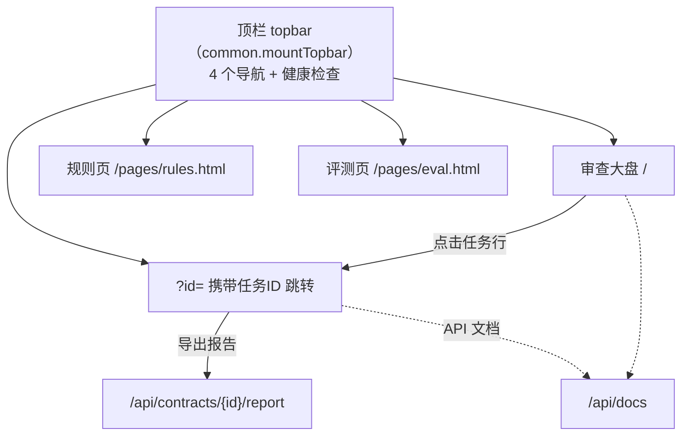

# 衡鉴 2.0 前端架构规范（frontend_design_spec）

> **一句话结论**：前端是零构建、零 CDN 的原生 HTML/CSS/JS 应用，4 个页面共用 `common.js` 基础设施，以「DOM + fetch + 字符区间求交」实现跨三源的高亮联动，状态组织靠模块级单例对象而非框架。

本文已读 `frontend/` 下真实文件核对（index.html / pages/*.html / assets/js/*.js）。

---

## 1. 页面清单

| 页面 | 文件 | 角色 | 挂载 JS |
| --- | --- | --- | --- |
| 审查大盘 | `index.html` | 任务总览、上传/拉取、实时流水线、状态分布 | common.js + dashboard.js |
| 智能审查工作台 | `pages/workbench.html` | 左文档视窗 + 右风险/结论/回写 三联动 | common.js + workbench.js |
| 合规规则与模板 | `pages/rules.html` | 规则树、规则详情编辑、示范条款库 | common.js + rules.js |
| 评测与观测 | `pages/eval.html` | 黄金样例跑分、系统观测 | common.js + eval.js |

---

## 2. 页面层级结构与跳转关系

- 跳转方式：纯 `<a href>`（多页应用，非 SPA 路由）；工作台通过 `?id=` 接收大盘选中任务。
- 顶栏：每个页面 `init` 调用 `HJ.mountTopbar(key)` 高亮当前导航并拉取 `/api/system/health`。

---

## 3. 核心交互

| 页面 | 交互 | 实现要点（源码核对） |
| --- | --- | --- |
| 大盘 | 拖拽/点击上传 | `dashboard.doUpload` → `FormData` → `/upload` |
| 大盘 | 实时进度 | `HJ.streamEvents` 订阅 `/events`，按 `progress` 更新进度条 |
| 大盘 | 筛选/搜索 | `status`/`risk`/`keyword` 查询参数 → `/contracts` |
| 工作台 | 双栏联动高亮 | 段落 `data-start/data-end` 与 finding `char_start/char_end` 用 `overlap()` 求交 |
| 工作台 | 划选原文反查风险 | `mouseup` 选区算字符区间，过滤 `findings`（`workbench.js`） |
| 工作台 | 采纳建议 | `/findings/{fid}/adopt` 弹窗可编辑 |
| 工作台 | HITL 决策 | `loadHitl` → `/hitl` 取可用动作 → `submitHitl` → `/human-review` |
| 工作台 | 回写预览/真实 | `/writeback/preview`、`/writeback` |
| 规则页 | 规则编辑升级版本 | `/rules/{id}` PUT，保存后提示去评测页跑分 |
| 评测页 | 跑黄金样例 | `/eval/run` persist=true |

---

## 4. 状态管理方式（无框架下）

无框架，状态分散在**模块级单例对象**与 DOM 中：

| 模块 | 状态对象 | 说明 |
| --- | --- | --- |
| `common.js` | `HJ`（IIFE 闭包） | 全局工具：api/esc/money/radar/md/streamEvents |
| `dashboard.js` | `state = {items, selected, timer, es}` | 大盘列表选中与 SSE 连接 |
| `workbench.js` | `W = {id, task, doc, findings, review, writeback, active, tab, es, clauseRanges}` | 工作台全量上下文 |
| `rules.js` | `R = {tree, flat, current, templates}` | 规则树与当前选中规则 |
| `eval.js` | 局部变量 | 评测/观测数据，无持久状态 |

**为什么不用全局 store**：页面是独立 HTML 文档，刷新即重建；跨页传递仅 `?id=` 与顶栏。状态即接口数据的缓存，重入页面即重新拉取，简单可靠。

---

## 5. 模块划分（js 职责）

| 文件 | 职责（禁止越界） |
| --- | --- |
| `common.js` | 请求封装 `api`、格式化（esc/money/dt/riskTag/statusTag）、通知 `toast`、模态 `modal`、顶栏 `mountTopbar`、SSE `streamEvents`、雷达图 `radar`、Markdown `md`、导航 `NAV`。**不含任何业务逻辑/判定**。 |
| `dashboard.js` | 大盘加载/上传/拉取/SSE 跟踪/流水线渲染。只调 contracts 与 stats 接口。 |
| `workbench.js` | 三栏联动、高亮、采纳、HITL、回写、报告、检索。核心交互层。 |
| `rules.js` | 规则树/详情/模板展示与编辑（PUT）。只调 rules/templates 接口。 |
| `eval.js` | 评测跑分与系统观测。只调 eval/score/stats/health 接口。 |

**前端铁律（详见《前后端职责边界》）**：风险等级判定、幂等判断、字符坐标计算**全部在后端**；前端只渲染后端给的坐标与等级，不做任何重新判定。

---

## 相关文档
- `06_architecture_design/frontend_backend_boundary_spec-v1.0.md`
- `06_architecture_design/系统架构设计文档.md`
- `07_data_model/领域数据模型定义.md`
