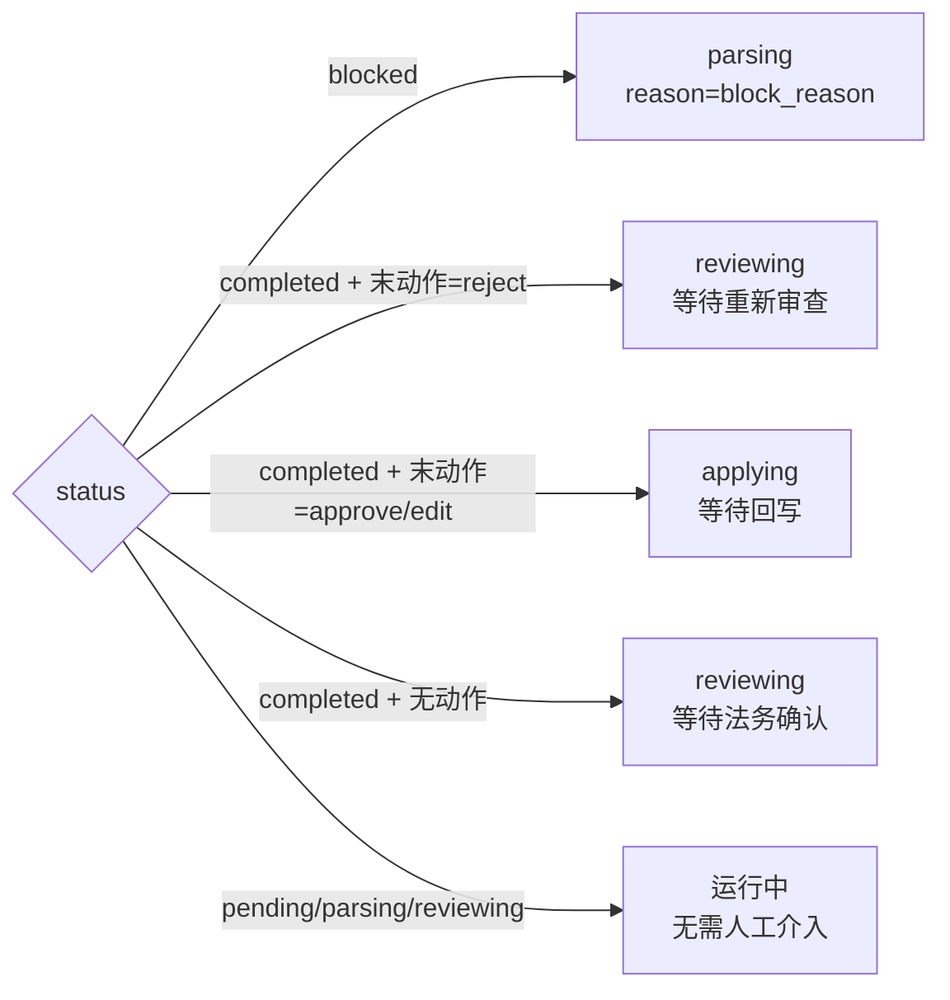

# 衡鉴 2.0 HITL 架构（基于 LangChain 人机交互范式）

> **一句话结论**：衡鉴的审核流程本质是一个「人工可中断-可恢复」的状态机，与 LangGraph 的 `interrupt/resume` 语义对齐，但我们选择了**自研轻量实现**而非引入 LangGraph，以守住零外部依赖、零运行服务、可控性的红线。

---

## 1. 本项目的 HITL 与 LangGraph `interrupt/resume` 语义对应

LangGraph 的核心概念：节点执行到 `interrupt()` 时**挂起检查点**（state 落盘），等待外部 `Command(resume=...)` 后从断点继续。衡鉴用更朴素的方式实现同一语义：

| LangGraph 概念 | 衡鉴实现 | 落点 |
| --- | --- | --- |
| `StateGraph` 节点 | 流水线阶段：`parsing`/`reviewing`/`applying` | `contracts.status` |
| `interrupt(point)` | `_interrupt_point()` 计算当前中断点 | `api/contracts.py` |
| 检查点（checkpoint） | 已完成产物（clauses/findings/reviews）持久化在库 | `contracts`+`findings` 等 |
| 人类输入 `Command` | `POST /{id}/human-review` 的 `action`+`note`+`edits` | `hitl_actions` |
| `resume` 恢复执行 | `retry()` / `run_pipeline()` 续跑 | `pipeline` |
| 边（条件分支） | `_available_actions()` 决定可执行动作 | `api/contracts.py` |

**关键对应**：LangGraph 的 `interrupt` 不是「报错」，而是「流程主动停下来等人做决定」——这与基线 6.3 完全一致：中断点必须给出可执行的下一步动作。

---

## 2. 中断点（interrupt point）如何定义

中断点定义在 `api/contracts.py` 的 `_interrupt_point(c)`（已读源码核对）：

| 中断点 | 触发条件 | 可执行动作 |
| --- | --- | --- |
| `parsing` | `status=blocked` | `resume` |
| `reviewing` | 审查完成，等待确认 | `approve` / `edit` / `reject` |
| `reviewing`（驳回后） | 末动作 `reject` | 无（需重跑） |
| `applying` | 已确认，等待回写 | `reject`（撤回确认） |
| — | 流水线运行中 | 无 |

`_available_actions()` 依据状态与末条 `hitl_actions` 收窄动作，**门禁**：被 `reject` 后回写接口返回 409。

---

## 3. 为什么不直接引入 LangGraph 而是自研轻量实现

### 3.1 依赖红线
- 项目明确「无 MySQL / Redis / 消息队列」（基线二）。引入 LangGraph 会连带引入 `langchain-core`、可能的 `langgraph-checkpoint`（需存储后端）、`langgraph-sdk` 等重依赖；演示现场「少一个依赖，少一个出问题的理由」（见 `llm.py` 传输层设计理念）。
- 自研实现仅用标准库 `threading`/`queue`/`sqlite3`，与现有 `pipeline.EventBus` 天然融合。

### 3.2 零外部服务
- LangGraph 的持久化检查点若上生产通常建议 Postgres/Redis；本项目用 SQLite 单文件存「检查点」（即业务表本身），无需新存储。

### 3.3 可控性
- 中断点判定、动作分支、重算逻辑全部在 `api/contracts.py` + `pipeline.py` 可读可控；自研状态机与任务状态机同源，调试链路短。
- 不需要学习 LangGraph 的编译/执行模型，团队可直读源码。

**代价**（自研的不足）：
- 缺少 LangGraph 的「图可视化」「条件边自动调度」「分布式检查点」等能力；
- 复杂多角色会签流程需自己扩展状态（本场景只有 单法务确认，够用）。

---

## 4. 若引入 LangGraph 的收益与代价（对照）

| 维度 | 引入 LangGraph 收益 | 引入 LangGraph 代价 |
| --- | --- | --- |
| 表达力 | 多节点图、自动条件边、并行分支 | 需把现有线性流水线重写为 `StateGraph` |
| 持久化 | 内置 checkpoint（断点续跑更稳） | 需接存储后端，打破零服务红线 |
| 可观测 | `langgraph` studio 可视化 | 增加运行期依赖与学习成本 |
| 升级成本 | — | 规则/坐标/回写逻辑需适配 Graph 状态对象 |

**结论**：当前单线 HITL + 单法务确认场景下，自研实现的简洁性收益 > LangGraph 的表达力收益；若未来扩展为「多部门会签 + 长时人工任务 + 跨机」，再评估引入 LangGraph（届时把 `pipeline` 包成 Graph 节点即可，接口边界不变）。

---

## 5. 动作语义（自研实现）

| 动作 | 语义 | 系统行为 |
| --- | --- | --- |
| `approve` | 同意系统结论 | 写 `hitl_actions`，解锁回写 |
| `edit` | 改等级/改建议后确认 | 更新 `findings`，重算综合风险等级+结论，`reviews.generated_by=human_edited` |
| `reject` | 驳回 | 清 findings/reviews，回 `pending` 自动重跑 |
| `resume` | 从阻塞恢复 | 等价 `retry`，保留中断上下文 |

> `hitl_actions` 与 `audit_logs` 分工：前者记**业务决策**，后者记**系统执行**。

---

## 相关文档
- `06_architecture_design/langchain_hitl_workflow_design-v1.0.md`
- `06_architecture_design/系统架构设计文档.md`
- `07_data_model/03_人机交互模型.md`
- `08_api_spec/服务边界与接口契约.md`
