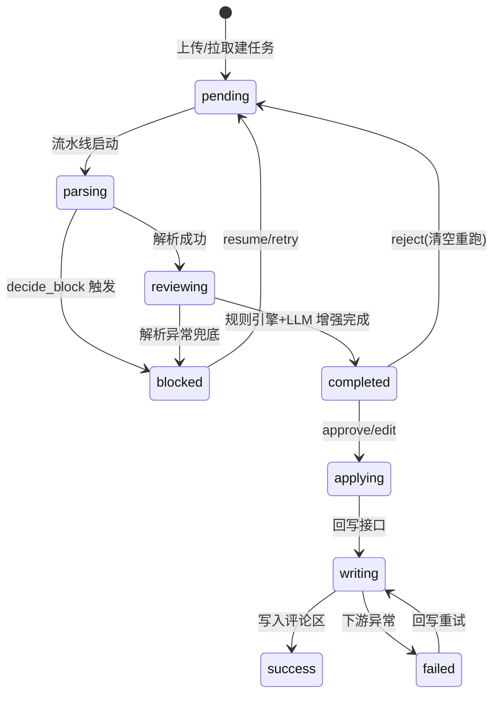
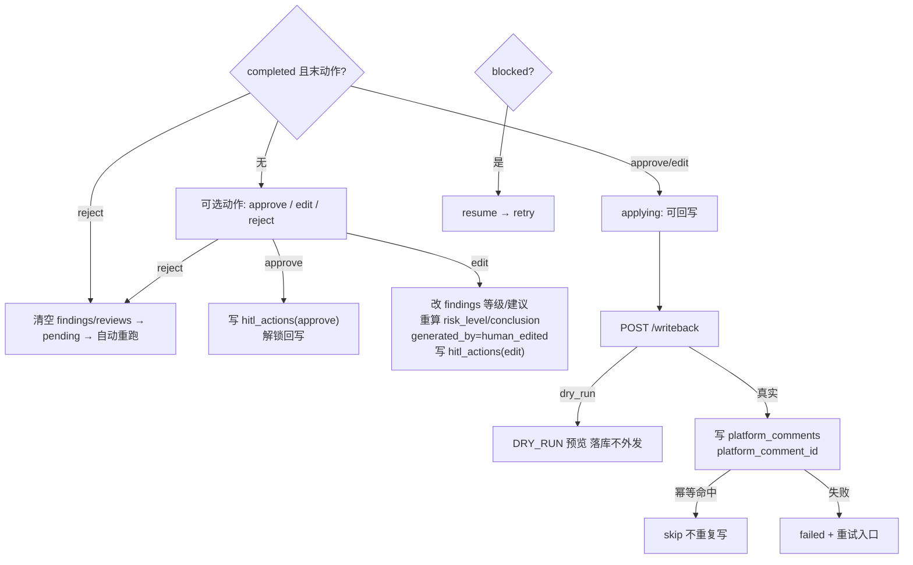

# 衡鉴 2.0 HITL 工作流设计（Workflow Design）

> **一句话结论**：审核工作流是一个「自动跑完 → 人工在中断点决策 → 续跑或回写」的闭环，由任务状态机与 `hitl_actions` 动作流水共同驱动，每个节点、中断条件、恢复条件、动作分支如下。

---

## 1. 状态节点与中断条件

---

## 2. 中断条件（interrupt）汇总

| 节点 | 中断条件 | 是否等待人 | 恢复方式 |
| --- | --- | --- | --- |
| `parsing`（blocked） | `decide_block` 返回阻塞（6 种 block_code） | 是 | `resume` → `pipeline.retry` |
| `reviewing`（completed 未确认） | 审查完成，等待法务确认 | 是 | `approve`/`edit`/`reject` |
| `reviewing`（reject 后） | 末动作=reject | 否（需重跑） | 系统自动 `run_pipeline` |
| `applying`（approve/edit 后） | 已确认，等待回写 | 是（可撤回） | `reject` 撤回确认 |
| 运行中（pending/parsing/reviewing） | — | 否 | 无需人工介入 |

---

## 3. 恢复条件（resume）

- `resume`：`status=blocked` 时可用 → 清空 clauses/findings/reviews（保留 writebacks/幂等键）→ 重跑。
- `reject` 后自动重跑：接口内直接 `pipeline.run_pipeline(contract_id)`，无需前端二次触发。
- 回写 `failed`：`POST /writeback/retry` 重新执行 `writeback.retry`。

---

## 4. 动作分支图

---

## 5. 动作分支明细

| 动作 | 前置状态 | 触发接口 | 写库 | 后续 |
| --- | --- | --- | --- | --- |
| `approve` | completed | `/human-review` action=approve | `hitl_actions` | 解锁回写 |
| `edit` | completed | `/human-review` action=edit + edits[] | `findings`(改级/改建议) + `reviews`(重算) + `hitl_actions` | 解锁回写 |
| `reject` | completed | `/human-review` action=reject | 清 `findings`/`reviews` + `hitl_actions` | 回 pending 自动重跑 |
| `resume` | blocked | `/human-review` action=resume | `hitl_actions` | `retry` 重跑 |

**门禁不变量**：
- `reject`/`approve`/`edit` 仅当 `status=completed`，否则 409。
- 被 `reject` 后回写返回 409（必须先重新审查）。
- `writeback` 仅 `status=completed` 可调用，否则 409。

---

## 相关文档
- `06_architecture_design/langchain_hitl_arch-v1.0.md`
- `06_architecture_design/系统架构设计文档.md`
- `07_data_model/03_人机交互模型.md`
- `08_api_spec/服务边界与接口契约.md`
