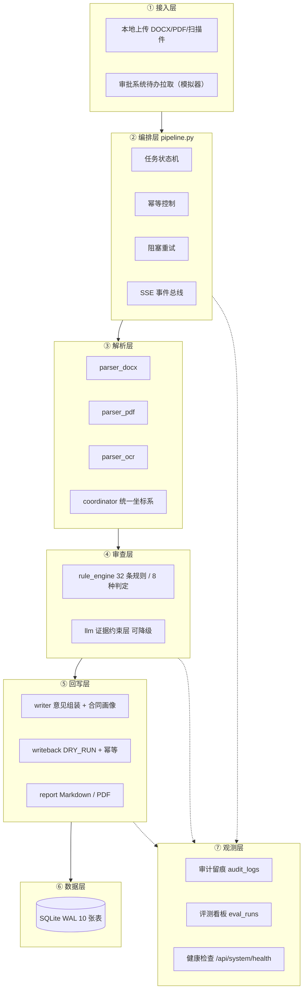
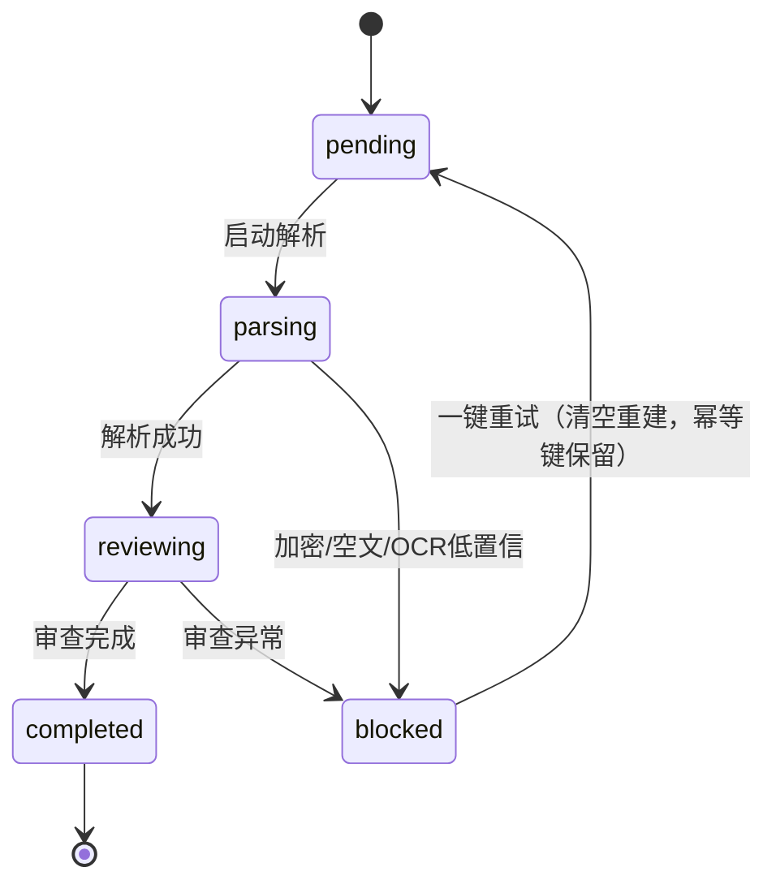

# 衡鉴 · 企业合同智能审查系统 · 技术方案（v2.0）

> **一句话结论**：这是一套**以确定性规则引擎为判定主体、以大模型为语义增强**的合同审查系统 ——
> 判定可复现、结论可溯源、外部依赖可降级，且完整实现已在本机跑通并留有可复现的验证证据。

| 项 | 内容 |
| --- | --- |
| 系统代号 | **衡鉴（HengJian）** —— 衡之对等公允，鉴之明察留痕 |
| 版本 | 2.0.0 |
| 方案日期 | 2026-09-19 |
| 需求出处 | 《项目实战》2.4 合同审批审查系统（2.4.1–2.4.10） |
| 代码规模 | 后端 30 个 Python 文件 + 前端 10 个静态文件 + 配置 6 个，git 追踪 58 个文件 |
| 验证状态 | 单元测试 **39/39**、接口冒烟 **64/64**、评测高风险召回 **100%**、误报 **0** |

---

## 一、问题定义：审批人只有几分钟，却要读懂几十页合同

企业合同审批的真实痛点从来不是"没有制度"，而是**审批人要在几分钟内对一份几十页的合同做出专业判断**：

| 痛点 | 具体表现 | 后果 |
| --- | --- | --- |
| **看不完** | 一份采购合同 30–60 页，逐条通读需 2 小时以上 | 审批流卡在人身上，业务等不起 |
| **看不准** | 风险藏在"违约责任""争议管辖""知识产权"等少数条款里 | 缺一条验收前置条件，可能就是全款风险 |
| **说不清** | 审批意见靠口头与批注，历史合同无法复盘 | 出了纠纷，责任链断在半路 |

**本方案的问题定义**：在**不改变审批权责**的前提下，把"读合同、找风险、写意见"三步自动化，
让审批人只做一件事 —— **做决定**。

---

## 二、核心主张：谁有权下结论

这是整套系统最重要的一条设计判断，也是与"把合同丢给大模型"最本质的区别：

| 角色 | 权限 | 理由 |
| --- | --- | --- |
| **确定性规则引擎** | **判定风险等级、给出命中项与原文坐标** | 同一份合同、同一版规则，任何时候跑都必须得到同一份结论。**可复现才能被法务采信** |
| **大模型（LLM）** | 只做三件事：解释成因、润色示范条款、检测跨条款矛盾 | 这些恰恰是规则写不出来、而模型擅长的部分 |
| **法务审查人** | 采纳/调整建议、补充批注、决定是否回写 | 系统的输出是"意见"，不是"结论" |

**约束落地方式**（不是写在文档里的口号，而是代码里的硬约束）：

1. `llm.py` 的 Prompt 中明确禁止新增、删除、合并风险项，禁止修改风险等级；
2. LLM 输出必须通过结构校验（`items` 必须是数组、`rule_id` 必须对应已有命中项），失败即降级；
3. 后端**不存在**任何审批结论写操作接口（通过 / 拒绝 / 转交 / 撤回）；
4. 审查意见文本中固定包含边界声明。

---

## 三、七层架构



**分层约束**：依赖方向单向向下（`api → services → db/config`），
禁止 service 反向 import api，禁止解析层直接写回写层的表。

---

## 四、三个技术支点

### 4.1 支点一：统一坐标系（证据链的地基）

**唯一真理坐标系 = 解析出的全文字符串 `full_text`。**
任何一条风险记录都必须能落到 `full_text` 的 `[char_start, char_end)` 区间；
`page` / `para_index` 只是给人读的"人话定位"。

| 来源 | 页码来源 | 定位精度 |
| --- | --- | --- |
| DOCX | 识别 `w:lastRenderedPageBreak` 与显式分页符；**无分页信息时如实退化为 page=1** | 段落 + 字符区间 |
| PDF | PyMuPDF 页序号（天然真实） | 页 + 块 + 字符区间 |
| 扫描件 | OCR 行框按 (y, x) 还原阅读顺序 | 行 + 字符区间 |

**为什么这是壁垒**：多数方案止步于"给出风险段落文字"，
而**从风险到字符级定位的完整证据链**才是法务敢采信的前提。
它同时解决了三个问题：

1. 前端只需要**一种高亮逻辑**就能支持三种文档格式（字符区间求交）；
2. 合同画像、报告导出、回写正文都能复用同一套坐标；
3. 出现争议时，可以逐字复核"系统凭什么这么判"。

**不做什么**：不做"估算页码"。DOCX 没有分页信息时直接标 `page=1`，
不伪造一个看起来专业的页码 —— 假定位比没定位更危险。

### 4.2 支点二：视角解析（防误报的关键）

> "知识产权归甲方所有"这句话，在采购合同里**对我方有利**，在销售合同里**对我方不利**。

脱离合同视角的关键词匹配必然大面积误报。规则库用 `{我方}` / `{对方}` 占位书写，
运行期按业务类型实例化：

| 业务类型 | 我方 | 对方 |
| --- | --- | --- |
| 采购 / 服务 / 劳动 | 甲方（需方／委托方／用人单位） | 乙方 |
| 销售 | 乙方（卖方／供方） | 甲方 |

配套机制：

- **规则级适用范围** `biz_types`：如"付款须挂钩验收"不适用于劳动合同；
- **语境排除** `exclude_keywords`：如"累计不超过合同总价的 20%"是**上限保护**，不是违约金比例风险；
- **共现判定**：只有同一句话里既出现付款语境、又出现验收语境，才认定"付款已挂钩验收"
  （否则质量保证条款里一句"质保期为验收合格后 12 个月"会把付款环节没有验收前置的问题掩盖掉）。

### 4.3 支点三：双引擎与可降级（演示零事故）

```
合同文本 ──► ① 确定性规则引擎（主路径）
                ｜ 32 条 YAML 规则 · 8 种判定类型 · 视角解析
                ｜ 输出：rule_id、风险等级、证据片段坐标、法条依据、规则版本
                ▼
             ② LLM 语义层（增强路径，可降级）
                ｜ 成因解释、示范条款润色、跨条款矛盾检测
                ｜ 输入仅含"规则命中证据"，不负责下判定
                ▼
             综合风险等级 = 命中项的最高等级
```

**降级策略**（每一条都有对应实现与测试）：

| 外部依赖 | 不可用时 | 用户体验损失 |
| --- | --- | --- |
| 大模型接口 | 超时（默认 8s）或返回非法 JSON → 切换确定性模板生成器 | 解释文字由模板拼装，**结论与建议完全不变** |
| OCR 引擎 | 扫描件进入 `blocked`，阻塞原因明确写"引擎缺失" | 提示安装 `rapidocr-onnxruntime`，不影响其他格式 |
| 网络 | 全链路本地运行，无外网依赖 | 无损失 |

---

## 五、规则体系

**版本 v1.0.0 ｜ 32 条规则（高 11 / 中 13 / 低 8）｜ 14 套标准示范条款**

### 5.1 八种判定类型

| type | 语义 | 为什么需要它 |
| --- | --- | --- |
| `keyword` | 关键词命中（any / all / none） | 覆盖绝大多数"明显违规表述" |
| `regex` | 正则匹配 + 语境排除 | 处理"同一方 + 隔几个字 + 加重措辞"的句式 |
| `numeric` | 数值阈值比对（多模式 + 排除设上限表述） | 违约金比例、预付款比例这类**必须算数**的问题 |
| `imbalance` | 权责不对等的关键词版 | 简单配对场景 |
| `imbalance_regex` | 权责不对等的正则版 | 只有**跨句比较**才能发现的不对等 |
| `missing_clause` | 必备条款缺失 | "没写的"和"写错的"一样危险 |
| `required_combo` | 条款组合缺失（共现 + 前提 + 反向排除） | "有付款、没验收"这类组合缺陷 |
| `absent` | 全篇缺少某项必要约定（支持前提条件） | 通知送达、金额大写、签署日期等要素级缺失 |

### 5.2 十一条条款本体树

`subject` 签约主体 ｜ `subject_matter` 标的物 ｜ `payment` 价款支付 ｜ `delivery` 交付验收 ｜
`liability` 违约责任 ｜ `confidentiality` 保密义务 ｜ `ip` 知识产权 ｜ `data_security` 数据安全 ｜
`dispute` 争议管辖 ｜ `validity` 合同效力 ｜ `force_majeure` 不可抗力

**条款切分策略**：标题正则识别 → 标题语义向下传播 → 正文需 2 个关键词自证才允许切换类型
→ 切换要求**严格优于当前上下文**（平局保持归属）。

> **踩坑记录**：条款词表里一旦放入角色词（甲方/乙方），
> 会把"知识产权段落"判成"签约主体段落"，连带整篇风险命中全部失效。
> 这是实测踩出来的，因此词表中刻意不含角色词。

---

## 六、数据模型

SQLite（WAL），**10 张表**：

| 表 | 职责 | 关键设计 |
| --- | --- | --- |
| `contracts` | 合同/任务主表 | `idem_key` 条件唯一索引实现幂等 |
| `documents` | 附件与解析状态 | 存 `sha256` 与 `parse_engine`，可复现 |
| `clauses` | 条款结构树 | `char_start / char_end` 是证据链的锚点 |
| `findings` | 风险命中 | 同时存"证据原文"与"坐标"，并区分 `judge_mode`（rule/llm） |
| `reviews` | 审查意见 | 记录 `generated_by`（template / llm / human_edited） |
| `writebacks` | 回写状态机 | 幂等键 + 尝试次数 + 错误信息 |
| `audit_logs` | 全链路留痕 | step / tool / 输入输出摘要 / 耗时 |
| `eval_runs` | 评测历史 | 每次规则变更的跑分快照 |
| `platform_comments` | 审批评论区（模拟器） | 接入真实系统时替换适配器即可 |
| `hitl_actions` | 人工审核动作流水 | **用动作流水代替状态字段** |

**为什么 HITL 不落状态字段而落流水**：谁在什么时候同意/修改/驳回了什么，天然可追溯 ——
审计信息就是业务数据本身，不需要额外维护状态迁移日志。

---

## 七、状态机

### 7.1 任务状态



### 7.2 六种阻塞代码（必须可区分）

| 代码 | 触发条件 | 为什么单独区分 |
| --- | --- | --- |
| `DOC_ENCRYPTED` | PDF 需要密码 | 需要用户去除密码，重试无意义 |
| `OCR_ENGINE_UNAVAILABLE` | 扫描件且 OCR 未安装 | 需要装环境，不是文件问题 |
| `OCR_LOW_CONFIDENCE` | 平均置信度 < 0.35 | 需要换清晰件 |
| `EMPTY_CONTENT` | 正文 < 120 字 | 可能是纯图片文档 |
| `PARSE_FAILED` | 解析器异常 | 需查审计日志 |
| `PIPELINE_ERROR` | 流水线未预期异常 | 需查 detail |

> **设计要点**："引擎缺失"与"图片模糊"必须分开记录 —— 否则重试没有意义，
> 用户只会反复点重试然后放弃。

### 7.3 人工审核（HITL）

与 LangGraph 的 `interrupt / resume` 语义对齐：中断点不是"报错"，
而是**流程主动停下来等人做决定**的位置。

| 动作 | 语义 | 系统行为 |
| --- | --- | --- |
| `approve` | 同意审查结论 | 记录流水，解锁回写 |
| `edit` | 修改等级/建议后确认 | 更新 `findings`，重算综合风险等级与结论 |
| `reject` | 驳回审查结果 | 清空本次产物，任务回 `pending` 并自动重跑 |
| `resume` | 从阻塞中断点恢复 | 等价重试，但保留中断上下文 |

**门禁**：审查结果被驳回后回写接口返回 409 —— 必须先重新审查。

---

## 八、审批回写安全边界

| 措施 | 实现 |
| --- | --- |
| 只写评论 | 后端无任何审批结论写操作接口 |
| DRY_RUN 前置 | 回写前先生成待写入正文，预览模式只落库不外发 |
| 幂等三键 | `合同编号 \| 附件SHA256 \| 规则版本号`，重复触发返回既有结果并记 `writeback.skip` 警告 |
| 状态机兜底 | 任何下游异常落到 `failed`，保留错误与重试入口 |
| 审计闭环 | 每个步骤写 `audit_logs`，可从审查意见反查到完整处理链路 |

---

## 九、验证证据（全部为真实运行数据）

| 验证项 | 结果 | 复现命令 |
| --- | --- | --- |
| 单元测试 | **39 / 39 通过** | `cd backend && python -m pytest -q` |
| 接口冒烟 | **64 / 64 通过** | `python tools/smoke_api.py` |
| 端到端演示 | 8 步全部跑通 | `python demo.py` |
| 黄金样例集评测 | 解析 100%、高风险召回 **100%**(11/11)、中风险 **100%**(26/26)、**误报 0** | `python -m app.eval.run_eval` |

**端到端实测（01 软件采购合同·埋雷版）**：

- 解析：python-docx，4 页 / 1245 字 / 10 个条款节点
- 审查：命中 **11 项**（高 6 / 中 2 / 低 3），规则判定耗时 **1 ms**，结论 **建议拒绝**
- 六条高风险全部带精确坐标（示例：`HJ-H-001 知识产权归属相对方` → 第 2 页 段#19 `[627,687)`）
- 回写：DRY_RUN 预览 1732 字 → 真实写入 `CMT-000001` → 重复触发幂等跳过 → 评论区仍 1 条
- 报告：Markdown 3360 字 + PDF 导出成功
- 异常：加密件 `DOC_ENCRYPTED` → 重试仍 blocked 且不产生脏数据

> ⚠️ **诚实声明**：黄金标注与规则库由同一团队同步编写，
> 因此 100% 召回是**内部回归基线**，用于防止"改一条规则、伤三处条款"，
> **不等于**面对全新语料的泛化能力。真实泛化评估需要第三方独立标注的盲测集，已列入路线图。

---

## 十、工程与交付

| 项 | 方案 |
| --- | --- |
| 依赖管理 | uv（`uv venv` + `uv pip install -e .`） |
| 运行时依赖 | fastapi / uvicorn / PyYAML / python-docx / PyMuPDF / pillow（+ 可选 rapidocr-onnxruntime） |
| 零外部服务 | SQLite 而非 MySQL/Redis；无消息队列；LLM 用标准库 urllib 直连 |
| 部署 | Dockerfile（多阶段）+ docker-compose + Nginx（SSE 必须 `proxy_buffering off`） |
| 端口 | 本地与服务器均 8130 |
| CI | 4 道门禁：静态检查 → 单元测试 → **规则回归跑分** → 镜像构建 + 容器健康检查 |
| 一键启动 | `start.bat`（建环境 → 装依赖 → 生成样例 → 起服务 → 开浏览器） |

**CI 门禁三的特殊性**：回归跑分不是"跑一下看看"，而是**断言**：
高风险召回 < 100%、误报 > 0、解析成功率 < 100% 任一出现，流水线直接失败。
规则改动导致命中率退化会被 CI 拦住，这是"规则即代码"的落地方式。

---

## 十一、已知局限与演进路线

### 11.1 诚实的局限

| # | 局限 | 影响 | 现状 |
| --- | --- | --- | --- |
| 1 | 黄金集为内部自标注，缺乏第三方盲测 | 泛化能力未经验证 | 已列入路线图 |
| 2 | 条款切分为启发式（标题正则 + 关键词传播） | 排版异常合同可能切错 | 有 11 类覆盖，但未做句式级解析 |
| 3 | 单机 SQLite + 进程内事件总线 | 无法水平扩展 | 演示/单部门场景足够 |
| 4 | 无鉴权与 RBAC | 不可直接暴露公网 | 需求 2.4.2 的三角色权限【未开发】 |
| 5 | 审批系统为内置模拟器 | 未验证真实系统对接 | 适配器接口已预留（替换 `_submit_to_platform`） |
| 6 | 孪生演示台（单文件驾驶舱）未实现 | 演示形态少一种 | 【未开发】 |

### 11.2 演进路线

| 里程碑 | 内容 |
| --- | --- |
| M1 | 三角色 RBAC（法务审查人 / 业务经办人 / 系统管理员）+ 路由级权限表 |
| M2 | 第三方盲测集 + 泛化能力评估报告 |
| M3 | 真实审批系统接入（替换回写适配器、接入待办拉取） |
| M4 | 条款相似度检索（历史合同库）+ 多方协作批注 |
| M5 | 解析队列与配额、性能基准、水平扩展方案 |

---

## 十二、交付物清单

| # | 交付物 | 位置 |
| --- | --- | --- |
| 1 | 可运行系统（后端 + 前端 + 规则库 + 样例集 + 测试） | `backend/` `frontend/` |
| 2 | 本项目技术方案 | 本文档 |
| 3 | 系统架构设计文档 / 领域数据模型定义 / 服务边界与接口契约 | `docs/06_architecture_design/` `docs/07_data_model/` `docs/08_api_spec/` |
| 4 | API 接口规范文档 / 前后端工程代码骨架 / 前端交互设计规范 | `docs/08_api_spec/` `docs/09_frontend_plan/` `docs/05_prototype/` |
| 5 | 业务问题建模文档 / 竞品功能拆解报告 / 审核流程与状态设计 | `docs/03_problem_modeling/` `docs/02_competitor_analysis/` `docs/04_interaction_design/` |
| 6 | 集成联调计划 / 部署与运维规范 / 可交付运行产物 | `docs/11_integration/` `docs/12_release_deployment/` `docs/13_delivery/` |
| 7 | 审核规则体系梳理（黄金测试集 + 评测报告） | `docs/07_data_model/审核规则体系梳理.md` |
| 8 | 会议纪要 ×2 / 团队分工架构 / 任务清单 / 交付文档总览 | `docs/13_delivery/` `docs/00_setup/` |
| 9 | 演示脚本 / 验收对照表 / 全流程架构图 | `docs/13_delivery/` |
| 10 | 项目环境要求 / 设备手册 / 原始资产整理 | `docs/12_release_deployment/` `docs/13_delivery/` `docs/00_setup/` |

---

## 相关文档

- `docs/00_setup/项目事实基线.md` —— 全部数字与契约的唯一事实来源
- `docs/06_architecture_design/系统架构设计文档.md` —— 模块边界与架构决策记录
- `docs/07_data_model/审核规则体系梳理.md` —— 规则体系与回归评测报告
- `docs/04_interaction_design/审核流程与状态设计.md` —— 全链路时序与状态迁移
- `docs/13_delivery/验收对照表.md` —— 需求 2.4.10 逐条对照
