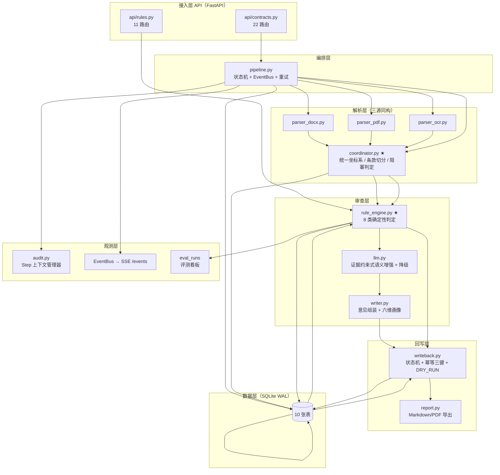
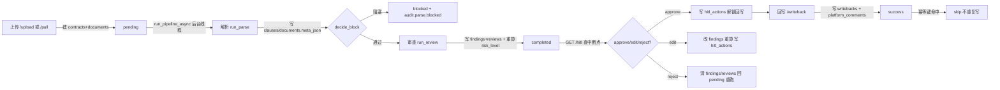

# 衡鉴 2.0 系统架构设计文档

> **一句话结论**：衡鉴以「统一坐标系 + 确定性规则引擎 + 可降级 LLM 语义层」为骨架，用零外部服务依赖（SQLite/线程/内存总线）的单机架构，把一份合同从上传到回写变成一条可审计、可复现、可人工介入（HITL）的流水线。

本文档是后端架构团队的正式交付物，所有模块名、表名、接口名、状态机均来自 `项目事实基线.md` 与源码核对（见文末「与源码核对修正」）。

---

## 1. 架构总览图

分层原则：**接入层**只做协议转换；**编排层**驱动状态机；**解析层**把三源收敛到统一坐标系；**审查层**做判定与解释；**回写层**把意见落地到审批单评论区；**数据层**单文件 SQLite(WAL)；**观测层**贯穿全程留痕与实时事件。

> **与基线一致性的说明**：基线第七章称「OpenAPI 共 29 个路径」，但源码实际注册 **33 个**（`api/contracts.py` 22 个 + `api/rules.py` 11 个）。本文与《服务边界与接口契约》以源码为准列出 33 个，并在文末记录该偏差。

---

## 2. 模块边界表

> 基线称「13 个 services」，但 `services/` 目录实际为 **11 个业务模块**；本表覆盖全部真实模块（11 services + 2 api + config/db/schemas），职责/输入/输出/依赖/禁止事项逐一定义。

| 模块 | 职责 | 输入 | 输出 | 依赖 | 禁止事项 |
| --- | --- | --- | --- | --- | --- |
| `config.py` | 集中全部可调参数，按用途分组（服务/LLM/解析/规则/回写/交付） | 环境变量 `.env` | 全局常量 | 无 | 禁止在模块内读取请求上下文；禁止硬编码路径（一律基于 `BASE_DIR`） |
| `db.py` | SQLite 连接池、DDL、事务、`init_db`/`reset_db` | 无 | `get_conn()`/`tx()` | config | 禁止业务 SQL 散落各 service；禁止关闭 WAL 或外键 |
| `schemas.py` | Pydantic 契约（含 approve/edit/reject 请求体） | JSON body | 校验后对象 | 无 | 禁止放置业务逻辑 |
| `api/contracts.py` | 合同审查全部接口、HITL 入口、`_interrupt_point` | HTTP | JSON / SSE | 全部 services | 禁止做判定；禁止改审批结论；只编排 |
| `api/rules.py` | 规则/模板/评测/系统/元数据接口 | HTTP | JSON | rule_engine | 禁止写 findings |
| `parser_docx.py` | DOCX 段落树（含分页标记识别） | 文件路径 | blocks | 无 | 禁止写库 |
| `parser_pdf.py` | PDF 文本层（图片型回退 OCR），抛 `PdfEncrypted` | 文件路径 | blocks | parser_ocr | 禁止写库 |
| `parser_ocr.py` | 扫描件 OCR（引擎缺失不崩，抛可读异常） | 文件路径 | (blocks, confidence) | 无 | 禁止在引擎缺失时静默返回空 |
| `coordinator.py` ★ | 统一坐标系、条款切分、元数据抽取、阻塞判定 | blocks | full_text + clauses + meta + block | config | 禁止做风险判定；**条款词表刻意不含角色词** |
| `rule_engine.py` ★ | 确定性判定（8 类）+ 视角解析 | clauses/full_text/ctx | findings | config | 禁止调用 LLM；判定必须可复现 |
| `llm.py` | 证据约束式语义增强（解释/润色/矛盾检测），可降级 | findings | 解释/建议 | config | **禁止新增或改风险项**；超时/非法即降级 |
| `writer.py` | 审查意见组装、合同画像六维评分 | findings/contract | summary/profile/markdown | rule_engine | 禁止独立判定 |
| `writeback.py` | 回写状态机、幂等三键、DRY_RUN | 意见正文 | writeback 记录 | config | **只写评论，不碰审批结论**；禁止跳过幂等 |
| `report.py` | Markdown/PDF 报告导出（PyMuPDF CJK） | 合同+findings | 文件/文本 | writer | 禁止写库 |
| `audit.py` | `Step` 上下文管理器，全链路留痕 | step/tool/成本 | audit_logs 行 | db | 禁止吞异常（必须落盘） |
| `pipeline.py` ★ | 状态机 + 内存 EventBus + 阻塞重试 + 后台线程 | contract_id | 任务状态流转 | 全部 services | 禁止在同步路由里跑长流水线（用后台线程） |

---

## 3. 关键数据流：合同从上传到回写

每步写入的表：

| 步骤 | 写入/更新的表 | 关键字段 |
| --- | --- | --- |
| 建任务 | `contracts`, `documents` | code, idem_key, status=pending |
| 解析 | `clauses`, `documents`, `contracts` | char_start/char_end, parse_engine, meta_json, biz_type |
| 阻塞 | `documents`, `contracts`, `audit_logs` | block_code, block_reason, status=blocked |
| 审查 | `findings`, `reviews`, `contracts`, `audit_logs` | level, char_start, risk_level, conclusion |
| 人工确认 | `hitl_actions`, (`findings`/`reviews` 若 edit) | action, interrupt_at |
| 回写 | `writebacks`, `platform_comments`, `audit_logs` | status, platform_comment_id, payload_md |

---

## 4. 统一坐标系的架构意义（技术壁垒）

**唯一真理坐标系 = 解析出的全文字符串 `full_text`**（见 `coordinator.normalize_blocks`：块间以单个 `\n` 连接，坐标逐字符等价）。任何一条风险记录都必须落到 `[char_start, char_end)`；`page`/`para_index` 只是给人看的定位。

三源同构映射（数据层完全同构，前端只需一种高亮逻辑）：

| 来源 | 页码来源 | 定位精度 | coordinator 处理 |
| --- | --- | --- | --- |
| DOCX | 识别 `w:lastRenderedPageBreak`/显式分页符；无则退化为 page=1 | 段落+字符区间 | `parser_docx` 出 blocks → `normalize_blocks` |
| PDF | PyMuPDF 页序号（天然真实） | 页+块+字符区间 | `parser_pdf`（图片型回退 OCR） |
| 扫描件 | OCR 行框按 (y,x) 还原阅读顺序 | 行+字符区间 | `parser_ocr` |

**为什么是壁垒**：多数方案止步于「给出风险段落文字」，而从风险到字符级定位的完整证据链才是法务采信前提；也让前端无需为每种格式写一套高亮。配合**条款切分策略**（标题正则 → 语义向下传播 → 正文需 2 关键词自证 → 严格优于当前上下文才切换），避免角色词污染条款类型（已踩坑：甲方/乙方计入打分会把「知识产权段」判成「签约主体段」）。

---

## 5. 并发模型

- **FastAPI 同步路由**：接口本身轻量（建任务/查状态），同步返回不阻塞事件循环。
- **后台线程跑流水线**：`pipeline.run_pipeline_async` 用 `threading.Thread(daemon=True)` 执行 `run_parse`+`run_review`；`upload` 默认 `auto_run=true` 上传即返回，前端看 SSE 进度。
- **内存 EventBus**：`pipeline.EventBus` 每个合同一条追加序列，SSE 按 `from_seq` 增量拉取；`subscribe/since/clear` 管理等待者队列。

**为什么不用消息队列 / Redis**：单机演示场景，进程内队列更简单、更可控，符合「零外部服务依赖」红线（基线第十章）。代价是跨进程/跨机不支持——演进路径见第 8 节。WAL 模式下 SQLite 多连接并发安全（`db._connect` 设 `busy_timeout=8000`、`foreign_keys=ON`）。

---

## 6. 可观测性设计

| 能力 | 实现 | 落点 |
| --- | --- | --- |
| 审计留痕 | `audit.Step` 上下文管理器，记录 step/tool/input_digest/output_digest/cost_ms/detail | `audit_logs` |
| SSE 实时流 | `/{id}/events` 推送 `data: {seq,contract_id,stage,message,progress,level,ts,extra}` | EventBus |
| 评测看板 | 黄金样例集跑分，逐份明细 | `eval_runs` + `/api/eval/score` |
| 健康探测 | `/api/system/health` 报告 LLM/OCR/规则/DB 状态 | 运维 |

设计要点：审计与业务解耦——`hitl_actions` 记**业务决策**，`audit_logs` 记**系统执行**，两者天然可追溯（见基线 5 末）。

---

## 7. 架构决策记录（ADR）

### ADR-1：规则引擎做判定，LLM 只做增强
- **决策**：风险等级与命中项 100% 由 `rule_engine` 产出；LLM 仅解释成因、润色建议、检测跨条款矛盾。
- **备选**：LLM 直接判定风险。
- **理由**：审查结论需「可复现、可审计、可追责」，同一合同同版规则须出同一清单；LLM 不可复现且会幻觉。
- **代价**：规则需人工维护；长尾语义风险靠 `llm.detect_conflicts` 辅助，不进主判定。

### ADR-2：SQLite 而非 MySQL
- **决策**：单文件 SQLite(WAL)。
- **备选**：PostgreSQL/MySQL 集群。
- **理由**：演示零事故、零运维；WAL 已支持并发读写；10 张表体量无需独立 DBMS。
- **代价**：不支持多写节点、跨机共享；演进需换存储引擎但接口（`db.get_conn/tx`）隔离了变更面。

### ADR-3：内存 EventBus 而非 Redis
- **决策**：进程内 `EventBus`（dict + Queue）。
- **备选**：Redis Pub/Sub / Kafka。
- **理由**：零外部服务红线；单机够用；SSE 增量拉取简单。
- **代价**：进程重启丢失历史事件（但 `audit_logs` 持久化，可回查）；多实例需改外部总线。

### ADR-4：后端渲染带锚点 HTML/段落，而非 pdf.js 文本层
- **决策**：`GET /{id}/document` 返回「段落 + 字符区间」，前端按 `char_start/char_end` 求交高亮。
- **备选**：前端用 pdf.js 文本层定位。
- **理由**：必须同时支持 docx/pdf/scan 三源同一套高亮；pdf.js 仅覆盖 PDF。
- **代价**：正文渲染依赖后端重算 blocks（接口内重新解析），有轻微额外耗时。

### ADR-5：引擎与模型可降级
- **决策**：LLM 超时/未配置/返回非法即降级模板生成器；OCR 缺失记录 `OCR_ENGINE_UNAVAILABLE` 而非崩溃。
- **备选**：强依赖，缺则报错。
- **理由**：演示现场断网/缺包也要出完整结论。
- **代价**：降级时解释质量下降（但判定不受影响）。

### 附加 ADR-6：HITL 落「动作流水」而非「状态字段」
- **决策**：`hitl_actions` 记录每次 approve/edit/reject/resume，当前状态由最后一条推出。
- **备选**：在 `contracts` 加 `hitl_state` 字段。
- **理由**：谁在何时同意/修改/驳回，天然可追溯，免维护状态迁移日志。
- **代价**：查当前状态需取最新一条（已用 `_last_hitl` 封装）。

---

## 8. 已知架构局限与演进路径

| 局限 | 影响 | 演进路径 |
| --- | --- | --- |
| 单机内存总线，进程重启丢实时事件 | SSE 历史需从 `audit_logs` 回查 | 事件异步落盘或换外部总线 |
| SQLite 不支持多写节点 | 横向扩容受限 | 抽象 `db` 层换 Postgres（接口已隔离） |
| 统一坐标系为单 `\n` 拼接，公式/表格跨行定位弱 | 复杂排版高亮偶有偏差 | 引入块级细分坐标 |
| 评测为内部回归基线（100% 召回 ≠ 泛化） | 泛化能力未独立验证 | 第三方盲测集（基线 8.1 已列路线图） |
| 回写为内置模拟器 `platform_comments` | 未接真实审批系统 | 抽 `writeback` 适配层对接 OA/BossPortal |
| 无鉴权/多租户 | 演示环境可信 | 接入 SSO（基线 10 已规划 BossPortal 跨端口） |

---

## 相关文档
- `06_architecture_design/backend_service_arch-v1.0.md`
- `06_architecture_design/langchain_hitl_arch-v1.0.md`
- `06_architecture_design/langchain_hitl_workflow_design-v1.0.md`
- `06_architecture_design/frontend_design_spec-v1.0.md`
- `06_architecture_design/frontend_backend_boundary_spec-v1.0.md`
- `07_data_model/领域数据模型定义.md`
- `08_api_spec/服务边界与接口契约.md`
- `00_setup/项目事实基线.md`
