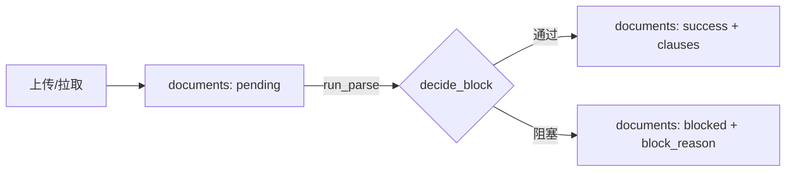

# 衡鉴 2.0 文档与任务模型（01）

> **一句话结论**：文档与任务模型以 `contracts` 为主表，`documents` 承载附件与解析状态，`clauses` 是统一坐标系下的条款结构树——三者构成"任务→附件→可定位条款"的锚定基础，所有风险坐标最终都落在 `clauses` 的字符区间上。

本文是《领域数据模型定义》的拆分篇，聚焦 contracts/documents/clauses 三表。

---

## 1. contracts —— 合同/任务主表

一份合同 = 一个审查任务。`status` 贯穿状态机，`idem_key` 保证同附件不重复建任务。

| 关键字段 | 含义 | 与流程的关系 |
| --- | --- | --- |
| code | `HJ-YYYYMMDD-HHMMSS-xxxx` | 末 4 位随机，避免同秒幂等键撞车 |
| biz_type | 采购/销售/服务/劳动/其他 | 驱动规则视角（我方=甲方/乙方），见 `rule_engine.build_ctx` |
| status | pending→parsing→reviewing→completed / blocked | 状态机唯一真相 |
| risk_level | high/medium/low/none | 由 findings 或 edit 重算 |
| idem_key | `code\|sha256\|rule_version` | 复用/幂等去重依据 |
| meta_json | 元数据（合同名/主体/金额/日期，含坐标） | `coordinator.extract_metadata` 产出 |
| profile_json | 合同画像六维评分 | `writer.build_profile` 产出 |

---

## 2. documents —— 文档与解析状态

每次上传/拉取生成一条文档记录，承载解析引擎、页数、字数、OCR 置信度与阻塞信息。

| 字段 | 含义 | 注意 |
| --- | --- | --- |
| file_type | docx/pdf/scan_pdf/image | `coordinator.detect_file_type` 判定（pdf 无文本→scan_pdf） |
| sha256 | 附件指纹 | `pipeline.file_sha256`，复用车判与幂等 |
| parse_engine | docx/pdf/ocr/plaintext | 实际使用的解析器 |
| parse_status | pending/success/blocked | 与 contracts.status 协同 |
| ocr_confidence | 扫描件置信度 | <阈值触发 `OCR_LOW_CONFIDENCE` |
| block_reason | 阻塞原因 | 6 种 block_code 之一 |

---

## 3. clauses —— 条款结构树（锚定基础）

`clauses` 是统一坐标系的落库形态：每个条款节点带 `char_start/char_end`，与 `full_text` 逐字符等价（重建验证见 `pipeline._rebuild_text`）。

| 字段 | 含义 | 重要性 |
| --- | --- | --- |
| clause_type | 11 类条款 + other | 前端高亮配色、规则作用域 |
| page / para_index | 人话定位 | 仅展示用 |
| char_start / char_end | **字符区间** | 高亮与风险锚定的唯一坐标 |
| text | 条款正文 | 文档视窗渲染 |
| confidence | 置信度 | 扫描件才有意义 |

**条款切分策略**（防误报关键）：标题正则识别 → 标题语义向下传播 → 正文需 2 关键词自证才允许切换 → 严格优于当前上下文才切换。词表刻意**不含角色词**（甲方/乙方），避免把「知识产权段」误判为「签约主体段」。

**关系**：`documents 1:N clauses`（CASCADE）；`contracts` 通过 `contract_id` 冗余关联便于查询。`findings.clause_id` 指向 clauses（SET NULL，条款删除不影响风险记录存在）。

---

## 4. 设计要点小结

- **坐标唯一真相**：`clauses.char_start/char_end` 与 `findings.char_start/char_end` 必须落在同一 `full_text` 区间，前端才能力求交高亮。
- **解析失败不污染审查**：`parsing` 阶段即分流 `blocked`，不会带空正文跑规则引擎（见 `pipeline` 设计要点）。
- **重试幂等**：`retry` 清 clauses/findings/reviews，但保留 documents 的 idem 上下文与 writebacks。

---

## 相关文档
- `07_data_model/领域数据模型定义.md`
- `07_data_model/02_审查结果与解释模型.md`
- `06_architecture_design/系统架构设计文档.md`
