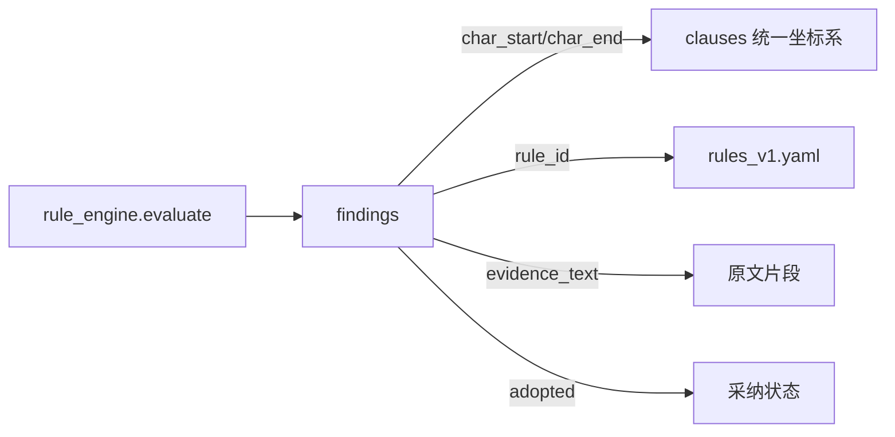
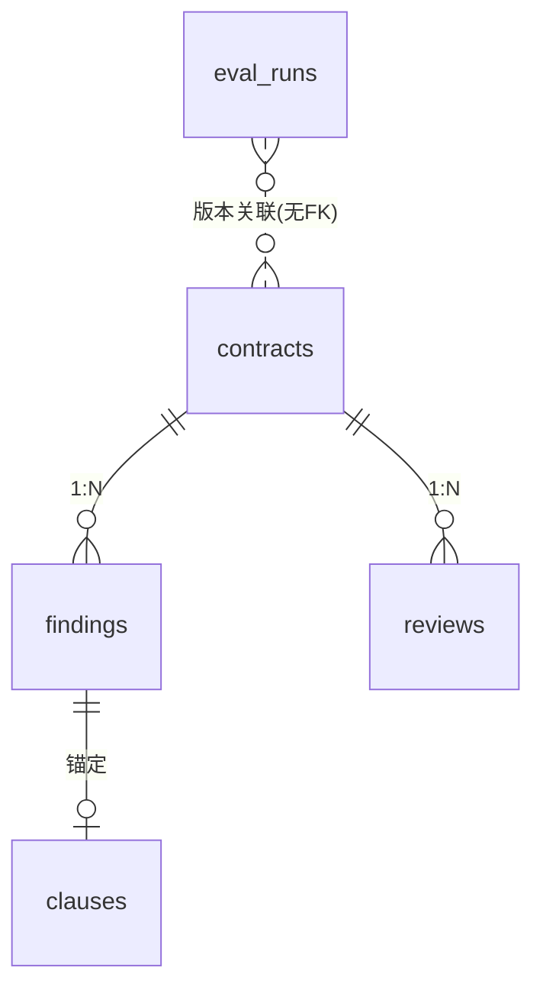

# 衡鉴 2.0 审查结果与解释模型（02）

> **一句话结论**：审查结果由 `findings`（带字符级证据链的风险命中）、`reviews`（综合意见）、`eval_runs`（回归跑分）三表承载；`findings` 每条都必须可回溯到规则编号、原文坐标与法条依据，是"风险可定位、依据可追溯"的落库形态。

本文是《领域数据模型定义》的拆分篇，聚焦 findings/reviews/eval_runs。

---

## 1. findings —— 风险命中（证据链核心）

每条 finding = 一次规则命中的完整证据：规则是谁、在哪段原文、为什么、依据什么、建议怎么改。

| 字段组 | 字段 | 含义 |
| --- | --- | --- |
| 归属 | contract_id, clause_id, rule_id, rule_version | 合同/锚定条款/命中规则/版本 |
| 判定 | level, clause_type, judge_mode | 等级/条款类型/`rule`或`llm` |
| 证据 | evidence_text, page, para_index, char_start, char_end | **原文 + 统一坐标系区间** |
| 解释 | reason, legal_basis, advice, advice_source | 成因/法条/建议/来源(template\|llm) |
| 采纳 | adopted, adopted_text | 法务是否采纳及采纳后文本 |
| 其他 | confidence, title, created_at | 置信度/标题/时间 |

**不变量**：任何 `findings` 记录必有 `char_start/char_end`（`>=0` 且 `end>start`），否则高亮与原文定位失效。缺失型规则（missing_clause/absent）若无锚点，坐标记为 `-1,-1` 并附文字说明。

**judge_mode**：主判定恒为 `rule`；`advice_source=llm` 仅表示"建议文本由 LLM 润色"，**不改变 level**（LLM 不下判定，见 `llm.py` 边界）。

---

## 2. reviews —— 审查意见

一份合同一份最新审查意见（重跑/编辑时整行替换）。

| 字段 | 含义 | 来源 |
| --- | --- | --- |
| risk_summary | 风险摘要 | `writer.build_summary`（LLM 增强或模板降级） |
| conclusion | 结论（通过/整改后通过/拒绝） | 由风险分布推出 |
| focus_points | 审批关注要点 JSON | 模板/LLM |
| high_cnt/medium_cnt/low_cnt | 各级数量 | `writer.count_levels` |
| reviewer_note | 法务批注 | `/annotations` 写入 |
| generated_by | template/llm/human_edited | 生成方式；`edit` 后置 human_edited |
| rule_version | 规则版本 | 当前生效版本 |

**不变量**：`completed` 状态下必有 `reviews` 记录；`edit` 人工改级后 `high_cnt/.../generated_by` 重算并重写本行。

---

## 3. eval_runs —— 评测跑分

黄金样例集回归结果，每次 `POST /eval/run` 持久化一行，供评测看板追溯。

| 字段 | 含义 |
| --- | --- |
| rule_version | 跑分所用规则版本 |
| total_cases / parse_ok | 样例总数 / 解析成功数（含加密件正确 blocked） |
| high_total / high_hit / high_recall | 高风险标注数 / 命中数 / 召回率 |
| false_positive / precision | 误报数 / 准确率 |
| avg_ms / verdict | 平均解析耗时 / 综合判定 pass\|fail |
| detail_json | 逐份明细（name/engine/blocked/high_found/high_miss/high_false…） |

> ⚠️ **诚实声明（原样引用基线 8.1）**：黄金标注与规则库由同一团队同步编写，100% 召回是**内部回归基线**，用于防"改一条规则伤三处条款"，**不等于**面对全新语料的泛化能力；真实泛化评估需第三方盲测集（【未开发】）。

---

## 4. 三表协作关系

- `findings`/`reviews` 均 `ON DELETE CASCADE` 随合同删除。
- `eval_runs` 独立，仅以 `rule_version` 字符串关联，不持有外键（避免与生产数据耦合）。

---

## 相关文档
- `07_data_model/领域数据模型定义.md`
- `07_data_model/01_文档与任务模型.md`
- `07_data_model/03_人机交互模型.md`
- `06_architecture_design/langchain_hitl_arch-v1.0.md`
