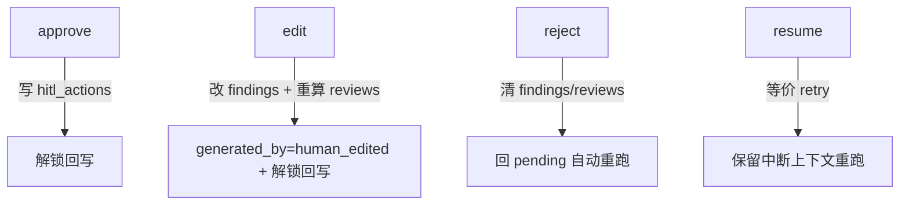

# 衡鉴 2.0 人机交互模型（03）

> **一句话结论**：HITL（人工审核）不落"状态字段"而落"动作流水"——`hitl_actions` 按时间顺序记录每一次 approve/edit/reject/resume，当前状态由最后一条动作推出；这样"谁在何时同意/修改/驳回了什么"天然可追溯，审计信息即业务数据本身。

本文是《领域数据模型定义》的拆分篇，聚焦 `hitl_actions`。

---

## 1. 为什么用「动作流水」代替「状态字段」

两种建模方式对比：

| 方式 | 做法 | 问题 |
| --- | --- | --- |
| 状态字段 | `contracts.hitl_state` 存当前态 | 状态迁移历史需额外日志表维护，易与业务数据不一致 |
| **动作流水（采用）** | `hitl_actions` 追加每次决策 | 历史即数据；`_last_hitl` 取末条即当前态，零额外维护 |

**核心收益**：审计信息就是业务数据本身。结合 `audit_logs`（系统执行）与 `hitl_actions`（业务决策）分工——前者记录"系统做了什么"，后者记录"人决定了什么"，两者从审查意见可完整反查。

---

## 2. hitl_actions 结构

| 字段 | 类型 | 含义 |
| --- | --- | --- |
| id | INTEGER PK | 主键 |
| contract_id | INTEGER FK CASCADE | 所属合同 |
| action | TEXT | `approve` / `edit` / `reject` / `resume` |
| actor | TEXT | 操作人 |
| note | TEXT | 审核意见/驳回理由 |
| interrupt_at | TEXT | 触发中断的环节（parsing/reviewing/applying） |
| payload_json | TEXT | 编辑内容（改等级/改建议/改批注） |
| created_at | TEXT | 时间 |

`interrupt_at` 由 `api/contracts._interrupt_point()` 计算，与 LangGraph `interrupt` 语义对齐（见 `langchain_hitl_arch`）。

---

## 3. 四种动作语义与系统行为

| 动作 | 前置状态 | 系统行为 | 写库 |
| --- | --- | --- | --- |
| approve | completed | 记录流水，解锁回写 | hitl_actions |
| edit | completed | 改 findings 等级/建议，重算 risk_level/conclusion，reviews.generated_by=human_edited | findings + reviews + hitl_actions |
| reject | completed | 清空 findings/reviews，回 pending 自动重跑 | 清 findings/reviews + hitl_actions |
| resume | blocked | 等价 retry，保留中断上下文 | hitl_actions |

---

## 4. 当前状态推导

`_last_hitl(contract_id)` 取末条动作，`_available_actions()` 据状态+末动作收窄可执行动作：

| status | 末动作 | 当前态(展示) | 可执行 |
| --- | --- | --- | --- |
| blocked | — | blocked | resume |
| completed | 无 | pending_review | approve/edit/reject |
| completed | approve | approved | reject(撤回) |
| completed | edit | edited | reject(撤回) |
| completed | reject | rejected | 无（需重跑） |

**门禁**：被 `reject` 后 `/writeback` 返回 409（必须先重新审查）。

---

## 5. 与回写/评论的关系

- `approve/edit` 是回写的前置解锁条件；`reject`（applying 阶段）可撤回确认。
- `writebacks` 与 `hitl_actions` 均随 `contracts` CASCADE 删除，互不持有外键，通过 `contract_id` 关联查询。

---

## 相关文档
- `07_data_model/领域数据模型定义.md`
- `06_architecture_design/langchain_hitl_arch-v1.0.md`
- `06_architecture_design/langchain_hitl_workflow_design-v1.0.md`
- `08_api_spec/服务边界与接口契约.md`
