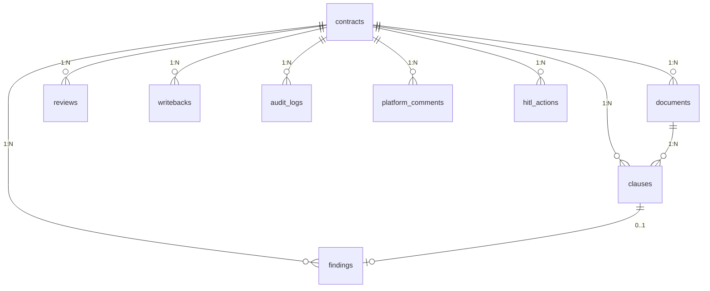

# 衡鉴 2.0 数据模型收口汇总（data_model_spec）

> **一句话结论**：本文件是数据模型的 Lead 视角收口——一张「字段含义总表」讲清每个字段是什么，一张「前后端字段职责划分」讲清谁算、谁展示，外加实体关系与跨文档索引，供各角色快速对齐。

---

## 1. 字段含义总表（按表）

> 完整字段类型/约束见《领域数据模型定义》。此处以"业务含义 + 谁负责"收口。

| 表 | 核心字段 | 业务含义 | 负责方 |
| --- | --- | --- | --- |
| contracts | code/idem_key/status/risk_level/conclusion | 任务身份/幂等/状态机/综合风险/结论 | 后端 |
| contracts | meta_json/profile_json | 元数据(含坐标)/六维画像 | 后端(coordinator/writer) |
| documents | sha256/file_type/parse_engine/ocr_confidence/block_reason | 指纹/格式/引擎/置信度/阻塞 | 后端 |
| clauses | clause_type/char_start/char_end/text | 条款类型/统一坐标系区间/正文 | 后端(coordinator) |
| findings | rule_id/level/char_start/char_end/evidence_text/reason/legal_basis/advice | 命中规则/等级/证据区间/成因/法条/建议 | 后端(rule_engine/llm) |
| reviews | risk_summary/conclusion/focus_points/generated_by | 摘要/结论/要点/生成方式 | 后端(writer/llm) |
| writebacks | status/idem_key/platform_comment_id/error | 回写状态机/幂等/评论ID/错误 | 后端(writeback) |
| audit_logs | step/tool/cost_ms/detail | 阶段/工具/耗时/详情 | 后端(audit) |
| eval_runs | high_recall/false_positive/precision/verdict | 召回/误报/准确率/判定 | 后端(eval) |
| platform_comments | author/body_md/kind | 评论作者/正文/类型 | 后端(writeback 模拟器) |
| hitl_actions | action/actor/interrupt_at/payload_json | 审核动作/人/中断点/编辑内容 | 后端(api) |

---

## 2. 前后端字段职责划分

### 2.1 后端负责"算"，前端负责"显"

| 类别 | 字段示例 | 后端 | 前端 |
| --- | --- | --- | --- |
| 判定结果 | findings.level, risk_level, conclusion | ✅ 唯一计算方 | 仅展示 |
| 坐标 | clauses/findings.char_start/char_end | ✅ 统一坐标系 | 仅用于高亮(求交) |
| 幂等 | idem_key, sha256 | ✅ 生成与校验 | 不接触 |
| 状态流转 | status, writebacks.status, hitl action | ✅ 状态机 | 仅读展示+发起动作 |
| 画像/元数据 | profile_json, meta_json | ✅ 计算 | 渲染雷达图/跳转 |
| 文案 | risk_summary, advice, reason | ✅ 生成(可LLM润色) | 展示 |
| UI 格式化 | 金额/日期/标签 | 提供原值 | ✅ money()/dt()/标签映射 |

### 2.2 前端禁止持有的"真相字段"

风险等级、字符坐标、幂等键、综合结论、条款类型——这些**只能来自后端响应**，前端不得自行推导或缓存跨会话（详见《前后端职责边界》）。

---

## 3. 实体关系说明（精简）

- 主表 `contracts` 一对多挂接全部业务子表（CASCADE 删除）。
- `audit_logs.contract_id` 可空、无外键（系统级审计独立保留）。
- `eval_runs` 仅凭 `rule_version` 字符串关联，不持有外键。
- 级联策略、索引设计详见《领域数据模型定义》第 3、4 节。

---

## 4. 跨文档索引

| 想了解 | 看 |
| --- | --- |
| 全字段类型/约束/索引/状态值域 | `07_data_model/领域数据模型定义.md` |
| 文档/任务模型细节 | `07_data_model/01_文档与任务模型.md` |
| 审查结果/解释模型 | `07_data_model/02_审查结果与解释模型.md` |
| 人机交互模型 | `07_data_model/03_人机交互模型.md` |
| 接口如何读写这些表 | `08_api_spec/服务边界与接口契约.md` |
| 前后端谁算谁显 | `06_architecture_design/frontend_backend_boundary_spec-v1.0.md` |

---

## 相关文档
- `07_data_model/领域数据模型定义.md`
- `07_data_model/01_文档与任务模型.md`
- `07_data_model/02_审查结果与解释模型.md`
- `07_data_model/03_人机交互模型.md`
- `06_architecture_design/frontend_backend_boundary_spec-v1.0.md`
- `08_api_spec/服务边界与接口契约.md`
