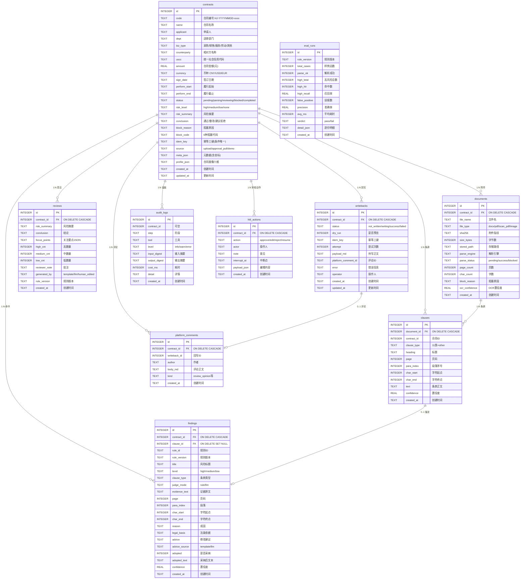

# 衡鉴 2.0 领域数据模型定义

> **一句话结论**：衡鉴用 1 个 SQLite 单文件库承载 **10 张表**，按「合同/文档/条款 → 风险/审查 → 回写/评论 → 审计/评测/HITL」分层，所有坐标与状态皆可溯源；本文与 `db.py` DDL 逐字段核对，无出入。

> ⚠️ **与基线核对修正**：基线第五章标题写「9 张表」，但其下列举了 10 张（含 `platform_comments`）；`db.py` SCHEMA 实际为 **10 张表**。本文以源码为准，记为 10 张。

---

## 1. 完整 ER 图

---

## 2. 逐表详解

### 2.1 contracts（合同/任务主表）
| 字段 | 类型 | 约束 | 含义 | 前端必展示 | 后端必存储 |
| --- | --- | --- | --- | --- | --- |
| id | INTEGER | PK 自增 | 主键 | 是(隐式) | 是 |
| code | TEXT | NOT NULL | 合同编号 `HJ-YYYYMMDD-xxxx` | 是 | 是 |
| name | TEXT | NOT NULL | 合同名称（可解析自动识别） | 是 | 是 |
| applicant | TEXT | DEFAULT '' | 申请人（业务经办人） | 是 | 是 |
| dept | TEXT | DEFAULT '' | 送审部门 | 是 | 是 |
| biz_type | TEXT | DEFAULT 'other' | 业务类型，驱动规则视角 | 是 | 是 |
| counterparty | TEXT | DEFAULT '' | 相对方主体名称 | 是 | 是 |
| uscc | TEXT | DEFAULT '' | 统一社会信用代码 | 是 | 是 |
| amount | REAL | 可空 | 合同金额（元） | 是 | 是 |
| currency | TEXT | DEFAULT 'CNY' | 币种 | 是 | 是 |
| sign_date / perform_start / perform_end | TEXT | 可空 | 签订/履行起止日期 | 否 | 是 |
| status | TEXT | DEFAULT 'pending' | 任务状态机 | 是 | 是 |
| risk_level | TEXT | DEFAULT 'none' | 综合风险等级 | 是 | 是 |
| risk_summary | TEXT | DEFAULT '' | 风险摘要 | 是 | 是 |
| conclusion | TEXT | DEFAULT '' | 审查结论 | 是 | 是 |
| block_reason / block_code | TEXT | DEFAULT '' | 阻塞原因/代码 | 是(blocked时) | 是 |
| idem_key | TEXT | DEFAULT '' | 幂等三键 `code\|sha256\|rule_version` | 否 | 是 |
| source | TEXT | DEFAULT 'upload' | 来源 | 否 | 是 |
| meta_json | TEXT | DEFAULT '{}' | 元数据抽取结果（含坐标） | 是(元数据显示) | 是 |
| profile_json | TEXT | DEFAULT '{}' | 合同画像六维评分 | 是(雷达图) | 是 |
| created_at / updated_at | TEXT | NOT NULL | 时间戳 | 是 | 是 |

### 2.2 documents（文档与解析状态）
| 字段 | 类型 | 约束 | 含义 | 前端必展示 | 后端必存储 |
| --- | --- | --- | --- | --- | --- |
| id | INTEGER | PK | 主键 | 否 | 是 |
| contract_id | INTEGER | FK→contracts CASCADE | 所属合同 | 否 | 是 |
| file_name | TEXT | NOT NULL | 文件名 | 是 | 是 |
| file_type | TEXT | NOT NULL | docx/pdf/scan_pdf/image | 是 | 是 |
| sha256 | TEXT | NOT NULL | 附件指纹（复用车判依据） | 部分 | 是 |
| size_bytes | INTEGER | DEFAULT 0 | 字节数 | 否 | 是 |
| stored_path | TEXT | DEFAULT '' | 存储路径 | 否 | 是 |
| parse_engine | TEXT | DEFAULT '' | 解析引擎标识 | 是 | 是 |
| parse_status | TEXT | DEFAULT 'pending' | pending/success/blocked | 是 | 是 |
| page_count / char_count | INTEGER | DEFAULT 0 | 页数/字数 | 是 | 是 |
| block_reason | TEXT | DEFAULT '' | 阻塞原因 | 是(blocked) | 是 |
| ocr_confidence | REAL | 可空 | OCR 置信度 | 是(扫描件) | 是 |
| created_at | TEXT | NOT NULL | 时间 | 否 | 是 |

### 2.3 clauses（条款结构树，锚定基础）
| 字段 | 类型 | 约束 | 含义 | 前端必展示 | 后端必存储 |
| --- | --- | --- | --- | --- | --- |
| id | INTEGER | PK | 主键 | 否 | 是 |
| document_id | INTEGER | FK→documents CASCADE | 文档 | 否 | 是 |
| contract_id | INTEGER | NOT NULL | 合同 | 否 | 是 |
| clause_type | TEXT | DEFAULT 'other' | 11 类条款+other | 是 | 是 |
| heading | TEXT | DEFAULT '' | 标题 | 否 | 是 |
| page | INTEGER | DEFAULT 1 | 页码 | 是 | 是 |
| para_index | INTEGER | DEFAULT 0 | 段落序号 | 否 | 是 |
| char_start / char_end | INTEGER | NOT NULL | **统一坐标系字符区间** | 是(高亮) | 是 |
| text | TEXT | NOT NULL | 条款正文 | 是(文档视窗) | 是 |
| confidence | REAL | 可空 | 置信度 | 否 | 是 |
| created_at | TEXT | NOT NULL | 时间 | 否 | 是 |

### 2.4 findings（风险命中，证据链核心）
| 字段 | 类型 | 约束 | 含义 | 前端必展示 | 后端必存储 |
| --- | --- | --- | --- | --- | --- |
| id | INTEGER | PK | 主键 | 是 | 是 |
| contract_id | INTEGER | FK→contracts CASCADE | 合同 | 否 | 是 |
| clause_id | INTEGER | FK→clauses SET NULL | 锚定条款（可空） | 否 | 是 |
| rule_id / rule_version | TEXT | NOT NULL | 命中规则及版本 | 是 | 是 |
| title | TEXT | NOT NULL | 风险标题 | 是 | 是 |
| level | TEXT | DEFAULT 'low' | 风险等级 | 是 | 是 |
| clause_type | TEXT | DEFAULT 'other' | 条款类型 | 是 | 是 |
| judge_mode | TEXT | DEFAULT 'rule' | rule/llm | 否 | 是 |
| evidence_text | TEXT | DEFAULT '' | 证据原文 | 是 | 是 |
| page / para_index | INTEGER | DEFAULT | 人话定位 | 是 | 是 |
| char_start / char_end | INTEGER | DEFAULT 0 | **证据字符区间（不变量）** | 是(高亮) | 是 |
| reason / legal_basis | TEXT | DEFAULT '' | 成因/法条依据 | 是 | 是 |
| advice / advice_source | TEXT | DEFAULT/template | 建议及来源 | 是 | 是 |
| adopted / adopted_text | INTEGER/TEXT | DEFAULT 0/'' | 采纳状态与文本 | 是 | 是 |
| confidence | REAL | 可空 | 置信度 | 否 | 是 |
| created_at | TEXT | NOT NULL | 时间 | 否 | 是 |

### 2.5 reviews（审查意见）
| 字段 | 类型 | 约束 | 含义 | 前端必展示 | 后端必存储 |
| --- | --- | --- | --- | --- | --- |
| id | INTEGER | PK | 主键 | 否 | 是 |
| contract_id | INTEGER | FK CASCADE | 合同 | 否 | 是 |
| risk_summary | TEXT | DEFAULT '' | 风险摘要 | 是 | 是 |
| conclusion | TEXT | DEFAULT '' | 结论（通过/整改/拒绝） | 是 | 是 |
| focus_points | TEXT | DEFAULT '[]' | 关注要点 JSON | 是 | 是 |
| high_cnt / medium_cnt / low_cnt | INTEGER | DEFAULT 0 | 各级数量 | 是 | 是 |
| reviewer_note | TEXT | DEFAULT '' | 法务批注 | 是 | 是 |
| generated_by | TEXT | DEFAULT 'template' | template/llm/human_edited | 是 | 是 |
| rule_version | TEXT | DEFAULT '' | 规则版本 | 是 | 是 |
| created_at | TEXT | NOT NULL | 时间 | 否 | 是 |

### 2.6 writebacks（回写状态机）
| 字段 | 类型 | 约束 | 含义 | 前端必展示 | 后端必存储 |
| --- | --- | --- | --- | --- | --- |
| id | INTEGER | PK | 主键 | 否 | 是 |
| contract_id | INTEGER | FK CASCADE | 合同 | 否 | 是 |
| status | TEXT | DEFAULT 'not_written' | not_written/writing/success/failed | 是 | 是 |
| dry_run | INTEGER | DEFAULT 1 | 是否预览模式 | 是 | 是 |
| idem_key | TEXT | DEFAULT '' | 幂等三键 | 是 | 是 |
| attempt | INTEGER | DEFAULT 0 | 尝试次数 | 否 | 是 |
| payload_md | TEXT | DEFAULT '' | 待写正文 | 是(预览) | 是 |
| platform_comment_id | TEXT | DEFAULT '' | **回写成功必有** | 是 | 是 |
| error | TEXT | DEFAULT '' | 错误信息 | 是(failed) | 是 |
| operator | TEXT | DEFAULT '' | 操作人 | 否 | 是 |
| created_at / updated_at | TEXT | NOT NULL | 时间 | 否 | 是 |

### 2.7 audit_logs（全链路留痕）
| 字段 | 类型 | 约束 | 含义 | 前端必展示 | 后端必存储 |
| --- | --- | --- | --- | --- | --- |
| id | INTEGER | PK | 主键 | 否 | 是 |
| contract_id | INTEGER | 可空 | 合同（系统级可空） | 否 | 是 |
| step / tool | TEXT | NOT NULL/DEFAULT '' | 阶段/工具 | 是(审计页) | 是 |
| level | TEXT | DEFAULT 'info' | info/warn/error | 是 | 是 |
| input_digest / output_digest | TEXT | DEFAULT '' | 输入/输出摘要 | 否 | 是 |
| cost_ms | INTEGER | DEFAULT 0 | 耗时 | 否 | 是 |
| detail | TEXT | DEFAULT '' | 详情 | 否 | 是 |
| created_at | TEXT | NOT NULL | 时间 | 否 | 是 |

### 2.8 eval_runs（评测跑分）
| 字段 | 类型 | 约束 | 含义 | 前端必展示 | 后端必存储 |
| --- | --- | --- | --- | --- | --- |
| id | INTEGER | PK | 主键 | 否 | 是 |
| rule_version | TEXT | DEFAULT '' | 规则版本 | 是 | 是 |
| total_cases / parse_ok | INTEGER | DEFAULT 0 | 样例数/解析成功 | 是 | 是 |
| high_total / high_hit | INTEGER | DEFAULT 0 | 高风险标注/命中 | 是 | 是 |
| high_recall / precision | REAL | DEFAULT 0 | 召回率/准确率 | 是 | 是 |
| false_positive | INTEGER | DEFAULT 0 | 误报数 | 是 | 是 |
| avg_ms | INTEGER | DEFAULT 0 | 平均耗时 | 是 | 是 |
| verdict | TEXT | DEFAULT 'pass' | pass/fail | 是 | 是 |
| detail_json | TEXT | DEFAULT '[]' | 逐份明细 | 是 | 是 |
| created_at | TEXT | NOT NULL | 时间 | 否 | 是 |

### 2.9 platform_comments（审批评论区模拟器）
| 字段 | 类型 | 约束 | 含义 | 前端必展示 | 后端必存储 |
| --- | --- | --- | --- | --- | --- |
| id | INTEGER | PK | 主键 | 否 | 是 |
| contract_id | INTEGER | FK CASCADE | 合同 | 否 | 是 |
| writeback_id | INTEGER | 可空 | 关联回写 | 否 | 是 |
| author | TEXT | DEFAULT '衡鉴审查助手' | 作者 | 是 | 是 |
| body_md | TEXT | NOT NULL | 评论正文 | 是 | 是 |
| kind | TEXT | DEFAULT 'review_opinion' | 评论类型 | 否 | 是 |
| created_at | TEXT | NOT NULL | 时间 | 否 | 是 |

### 2.10 hitl_actions（人工审核动作流水）
| 字段 | 类型 | 约束 | 含义 | 前端必展示 | 后端必存储 |
| --- | --- | --- | --- | --- | --- |
| id | INTEGER | PK | 主键 | 否 | 是 |
| contract_id | INTEGER | FK CASCADE | 合同 | 否 | 是 |
| action | TEXT | NOT NULL | approve/edit/reject/resume | 是 | 是 |
| actor | TEXT | DEFAULT '' | 操作人 | 是 | 是 |
| note | TEXT | DEFAULT '' | 意见 | 是 | 是 |
| interrupt_at | TEXT | DEFAULT '' | 中断点 | 是 | 是 |
| payload_json | TEXT | DEFAULT '{}' | 编辑内容 | 否 | 是 |
| created_at | TEXT | NOT NULL | 时间 | 否 | 是 |

---

## 3. 实体关系说明

| 关系 | 基数 | 外键 | 级联策略 |
| --- | --- | --- | --- |
| contracts → documents | 1:N | documents.contract_id | ON DELETE CASCADE |
| contracts → clauses | 1:N | clauses.contract_id | 应用层删除（清 clauses） |
| documents → clauses | 1:N | clauses.document_id | ON DELETE CASCADE |
| contracts → findings | 1:N | findings.contract_id | ON DELETE CASCADE |
| clauses → findings | 1:0..1 | findings.clause_id | ON DELETE SET NULL |
| contracts → reviews | 1:N | reviews.contract_id | ON DELETE CASCADE |
| contracts → writebacks | 1:N | writebacks.contract_id | ON DELETE CASCADE |
| contracts → audit_logs | 1:N | audit_logs.contract_id | 无外键约束（系统级可空，delete 不级联） |
| contracts → platform_comments | 1:N | platform_comments.contract_id | ON DELETE CASCADE |
| contracts → hitl_actions | 1:N | hitl_actions.contract_id | ON DELETE CASCADE |
| writebacks → platform_comments | 1:0..1 | platform_comments.writeback_id | 无外键（应用层关联） |

> `audit_logs.contract_id` 不设外键：系统级审计（如 `rule.update` step 的 contract_id 为 NULL）需独立保留。

---

## 4. 索引设计及其理由

| 索引 | 定义 | 理由 |
| --- | --- | --- |
| `ux_contracts_idem` | **条件唯一** `UNIQUE(idem_key) WHERE idem_key <> ''` | 幂等三键防重复任务；用 `WHERE idem_key<>''` 是因为空串（demo 无附件）不能强制唯一，否则阻断正常插入 |
| `ix_contracts_status` | `(status, risk_level)` | 大盘按状态/风险筛选与排序高频 |
| `ix_documents_contract` | `(contract_id)` | 任务详情取文档 |
| `ix_documents_sha` | `(sha256)` | 复用车判（同指纹复用任务） |
| `ix_clauses_contract` | `(contract_id, clause_type)` | 按条款类型聚合/高亮 |
| `ix_clauses_range` | `(document_id, char_start)` | 坐标定位 |
| `ix_findings_contract` | `(contract_id, level)` | 风险卡片按等级排序 |
| `ix_reviews_contract` | `(contract_id)` | 取最新审查意见 |
| `ix_writebacks_contract` | `(contract_id, status)` | 回写状态查询 |
| `ix_audit_contract` | `(contract_id, id)` | 审计按合同时间序 |
| `ix_comments_contract` | `(contract_id, id)` | 评论区列表 |
| `ix_hitl_contract` | `(contract_id, id)` | 取末条动作推当前状态 |

**为什么 `idem_key` 用条件唯一索引**：幂等键由 `code + sha256 + rule_version` 构成，仅当三键齐全才有去重意义；`create_task` 在 `sha` 非空且非 `force_new` 时复用既有任务，唯一索引是最后一道防线，避免并发插入重复任务。

---

## 5. 状态字段值域与流转约束

- `contracts.status`：`pending | parsing | reviewing | blocked | completed`。流转见《系统架构设计文档》状态机；`retry` 回 `pending` 并清 clauses/findings/reviews。
- `contracts.risk_level`：`high | medium | low | none`，由审查结果或 `edit` 人工重算推出。
- `documents.parse_status`：`pending | success | blocked`。
- `findings.level`：`high | medium | low`；`judge_mode`：`rule | llm`。
- `writebacks.status`：`not_written | writing | success | failed`；`success` 必带 `platform_comment_id`。
- `hitl_actions.action`：`approve | edit | reject | resume`；当前状态 = 末条动作推出。
- `eval_runs.verdict`：`pass | fail`。

**不变量（详见《服务边界与接口契约》）**：
- 任何 `findings` 必有合法 `char_start/char_end`（≥0 且 `end>start`）。
- `completed` 状态下必有 `reviews` 记录。
- `writebacks.status=success` 必有 `platform_comment_id`。

---

## 6. 数据保留与清理策略

- **演示/测试清理**：`db.reset_db()` 清空 10 张业务表（保留表结构），并清 `sqlite_sequence`。
- **级联删除**：删除 `contracts` 自动清 documents/clauses/findings/reviews/writebacks/platform_comments/hitl_actions（CASCADE）。
- **重试保留**：`retry` 清 clauses/findings/reviews 与 documents.parse_status，但**保留 writebacks 与 idem_key**（幂等键不因重试失效）。
- **长期保留**：`audit_logs` / `eval_runs` 不随任务删除清理，用于回溯与回归；生产环境建议按保留期归档（当前【未开发】）。
- **物理存储**：SQLite 单文件（默认 `backend/data/hengjian.db`），WAL 模式，数据卷挂载 `/data`（Docker）。

---

## 相关文档
- `07_data_model/01_文档与任务模型.md`
- `07_data_model/02_审查结果与解释模型.md`
- `07_data_model/03_人机交互模型.md`
- `07_data_model/data_model_spec-v1.0.md`
- `06_architecture_design/系统架构设计文档.md`
- `08_api_spec/服务边界与接口契约.md`
