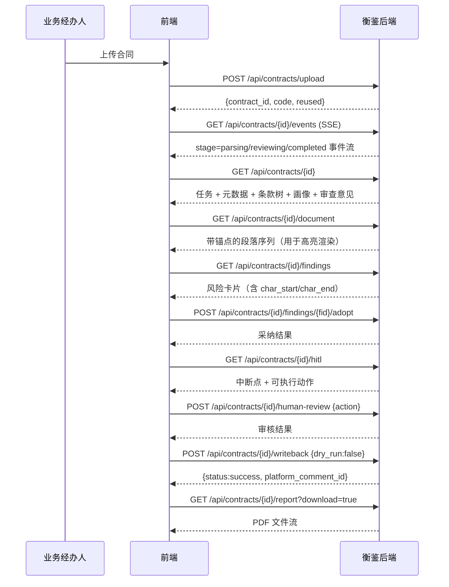

# 衡鉴 · API 接口规范文档（v1.0）

> **一句话结论**：系统对外暴露 **33 个 HTTP 路径**，全部由 FastAPI 自动生成 OpenAPI 契约
> （`GET /api/docs` 可交互调试），其中合同审查链路 21 个、HITL 人工审核 2 个、
> 规则与系统 11 个；**所有风险类接口返回的数据都带原文字符区间坐标**。

| 项 | 值 |
| --- | --- |
| BaseURL（本地） | `http://127.0.0.1:8130` |
| BaseURL（服务器） | `http://39.96.200.45:8130` |
| 接口数量 | 33 个路径 |
| 交互式文档 | `GET /api/docs`（Swagger UI）、`GET /api/redoc` |
| 机读契约 | `GET /api/openapi.json` |
| 数据格式 | JSON（UTF-8）；上传为 `multipart/form-data`；进度流为 `text/event-stream` |

---

## 一、通用约定

### 1.1 响应格式

**成功**：直接返回业务对象，不使用 `{code, data, msg}` 包装层。
理由：HTTP 状态码本身就能表达结果，再包一层只会让前端多写一层解包代码，且容易与业务码语义冲突。

**失败**：统一返回

```json
{ "detail": "可读的中文原因" }
```

（FastAPI `HTTPException` 的默认结构；500 由全局异常处理器补上 `error` 与 `path` 字段。）

### 1.2 状态码语义

| 状态码 | 何时出现 | 典型场景 |
| --- | --- | --- |
| 200 | 成功 | 常规查询与操作 |
| 400 | 请求本身有问题 | 不支持的文件类型、非法 action、`action=edit` 却未提供 edits、规则不存在 |
| 404 | 资源不存在 | 合同 ID / 风险项 ID / 模板 ID 不存在 |
| 409 | 状态冲突（**业务门禁**） | 未审查完成就回写；审查结果被驳回后回写 |
| 413 | 文件过大 | 超过 30MB |
| 500 | 服务端异常 | 文档重渲染失败、评测执行失败、未预期异常 |

> **409 是这套接口里最重要的状态码**：它承载的是"业务规则不允许你此刻做这件事"，
> 而不是"你的请求写错了"。前端必须把 409 的 `detail` 直接展示给用户，因为它就是操作指引。

### 1.3 响应头

| 头 | 含义 |
| --- | --- |
| `X-Process-Time-Ms` | 本次请求服务端处理耗时（毫秒），用于前端性能观测 |
| `X-HengJian-Version` | 系统版本号（当前 `2.0.0`），用于核对部署版本 |

### 1.4 鉴权

**当前版本无鉴权**（本地/内网演示场景）。
生产环境接入建议（**【未开发】**）：

1. 网关层接入企业 SSO（本项目既有 BossPortal 跨端口 SSO 方案可直接复用）；
2. 引入 RBAC，至少区分 `viewer`（只看）/ `editor`（可采纳与批注）/ `admin`（可改规则）三角色；
3. 规则编辑接口 `PUT /api/rules/{rule_id}` 与回写接口必须限制在 `admin` / `editor`。

### 1.5 限制

| 项 | 值 |
| --- | --- |
| 单文件上限 | 30 MB（`HJ_MAX_UPLOAD_MB`） |
| 支持扩展名 | `.docx` `.pdf` `.png` `.jpg` `.jpeg` `.bmp` `.tif` `.tiff` `.txt` `.md` |
| 列表默认条数 | 100（`limit` 最大 500） |
| SSE 空闲上限 | `idle_limit × 0.1s`，默认 150 → 15 秒无新事件则关闭连接 |

---

## 二、调用链路总览



---

## 三、合同审查接口（21 个）

### 3.1 上传合同

`POST /api/contracts/upload` ｜ `multipart/form-data`

| 参数 | 类型 | 必填 | 默认 | 说明 |
| --- | --- | --- | --- | --- |
| `file` | file | ✅ | — | 合同文件，见 §1.5 扩展名白名单 |
| `name` | string | — | "" | 合同名称，留空则取文件名（后续会被解析出的名称覆盖） |
| `applicant` | string | — | "" | 申请人 |
| `dept` | string | — | "" | 送审部门 |
| `biz_type` | string | — | `other` | 业务类型：`采购`/`销售`/`服务`/`劳动`/`other`。**该字段决定"我方"是哪一方，直接影响规则视角判定，建议显式传** |
| `auto_run` | bool | — | `true` | 是否后台自动启动审查流水线 |

```bash
curl -X POST http://127.0.0.1:8130/api/contracts/upload \
  -F "file=@01_软件采购合同_埋雷版.docx" \
  -F "biz_type=采购" -F "applicant=王倩" -F "dept=信息技术部" -F "auto_run=true"
```

```json
{
  "contract_id": 1,
  "code": "HJ-20260919-122111-10df",
  "reused": false,
  "sha256": "bdb7c77bbfdabf15851b7119e2a07dec1be48fc0e712c6926322bab194e5e255",
  "auto_run": true,
  "message": "任务已创建，正在后台解析与审查"
}
```

**幂等行为**：服务端对文件内容计算 SHA256。
若库中已存在相同 SHA256 且 `force_new=false`，则 `reused=true` 并直接返回既有任务 ID，
不重复解析、不重复审查。此时 `auto_run` 字段恒为 `false`。

**错误**：`400` 文件类型不支持 · `413` 超过 30MB。

---

### 3.2 从审批系统拉取待办

`POST /api/contracts/pull` ｜ `application/json`

```json
{ "count": 3, "auto_run": true }
```

| 字段 | 类型 | 默认 | 约束 | 说明 |
| --- | --- | --- | --- | --- |
| `count` | int | 3 | 1–20 | 拉取数量 |
| `auto_run` | bool | true | — | 是否自动启动流水线 |

```json
{ "count": 3, "auto_run": true,
  "items": [{ "contract_id": 2, "code": "HJ-...", "reused": false, "sha256": "..." }] }
```

> **说明**：当前为**内置模拟器**，按 `backend/samples/` 目录顺序生成待审任务。
> 接入真实审批系统时替换 `ingest` 层的拉取实现即可，接口契约不变。

---

### 3.3 审查任务列表（大盘）

`GET /api/contracts`

| Query | 类型 | 说明 |
| --- | --- | --- |
| `status` | string | `pending`/`parsing`/`reviewing`/`blocked`/`completed` |
| `risk` | string | `high`/`medium`/`low`/`none` |
| `biz_type` | string | 业务类型 |
| `keyword` | string | 模糊匹配合同名称 / 编号 / 相对方 |
| `limit` | int | 默认 100，最大 500 |

```bash
curl "http://127.0.0.1:8130/api/contracts?status=completed&risk=high"
```

```json
{
  "total": 1,
  "items": [{
    "id": 1, "code": "HJ-20260919-122111-10df",
    "name": "企业资源管理系统软件采购合同",
    "applicant": "王倩", "dept": "信息技术部", "biz_type": "采购",
    "counterparty": "郑州辰星软件科技有限公司",
    "amount": 1860000.0, "currency": "CNY",
    "status": "completed", "risk_level": "high", "conclusion": "建议拒绝",
    "block_reason": "", "file_type": "docx",
    "high_cnt": 6, "medium_cnt": 2, "low_cnt": 3,
    "created_at": "2026-09-19T12:21:11", "updated_at": "2026-09-19T12:21:12"
  }]
}
```

排序规则：**风险等级优先（高 → 中 → 低 → 无），同级按创建时间倒序**。
这样大盘打开时"最该看的"永远在最上面。

---

### 3.4 任务详情

`GET /api/contracts/{contract_id}`

一次返回工作台首屏所需的全部数据，避免前端发 5 个请求。

```json
{
  "task": { "...同 3.3 的单项结构..." },
  "document": {
    "file_name": "01_软件采购合同_埋雷版.docx", "file_type": "docx",
    "parse_engine": "python-docx", "parse_status": "success",
    "page_count": 4, "char_count": 1245,
    "sha256": "bdb7c77b...", "ocr_confidence": null, "block_reason": ""
  },
  "meta": [
    { "key": "contract_name", "label": "合同名称", "value": "企业资源管理系统软件采购合同",
      "page": 1, "para_index": 0, "char_start": 0, "char_end": 14 },
    { "key": "contract_code", "label": "合同编号", "value": "HJ-CG-2026-0913",
      "page": 1, "para_index": 5, "char_start": 267, "char_end": 282 }
  ],
  "profile": {
    "scores": { "completeness": 88, "balance": 32, "payment_safety": 0,
                "ip_protection": 0, "dispute_friendliness": 66, "text_quality": 94 },
    "dimensions": [{ "key": "balance", "label": "权责对等度", "score": 32 }],
    "overall": 47
  },
  "review": {
    "risk_summary": "本次审查共命中 11 项风险：高风险 6 条、中风险 2 条、低风险 3 条...",
    "conclusion": "建议拒绝", "focus_points": ["[必须整改] ..."],
    "high_cnt": 6, "medium_cnt": 2, "low_cnt": 3, "reviewer_note": "",
    "generated_by": "template", "rule_version": "1.0.0"
  },
  "writeback": { "status": "not_written", "dry_run": true, "platform_comment_id": "",
                 "error": "", "attempt": 0, "idem_key": "", "updated_at": "" },
  "clauses": [{
    "id": 6, "clause_type": "ip", "clause_label": "知识产权",
    "heading": "第四条　知识产权归属", "page": 2, "para_index": 19,
    "char_start": 616, "char_end": 723, "text": "第四条　知识产权归属\n本合同项下..."
  }]
}
```

`meta[].char_start = -1` 表示该元数据无法在原文定位（如币种这类推断字段）。
**前端遇到 -1 时不应渲染"定位"按钮**，而不是跳到一个假位置。

---

### 3.5 文档视窗（带锚点段落序列）

`GET /api/contracts/{contract_id}/document`

这是"双栏联动高亮"的数据来源。**返回的是后端重新解析出的段落 + 字符区间，
而不是 pdf.js 的文本层** —— 因为我们要求 DOCX / PDF / OCR 三种来源共用同一套高亮逻辑。

```json
{
  "contract_id": 1,
  "file_name": "01_软件采购合同_埋雷版.docx",
  "file_type": "docx",
  "page_count": 4,
  "paragraphs": [
    { "page": 1, "para_index": 0, "char_start": 0, "char_end": 14,
      "text": "企业资源管理系统软件采购合同",
      "clause_type": "other", "clause_label": "其他条款", "is_heading": false },
    { "page": 2, "para_index": 19, "char_start": 616, "char_end": 626,
      "text": "第四条　知识产权归属",
      "clause_type": "ip", "clause_label": "知识产权", "is_heading": true }
  ]
}
```

**前端使用方式**：把每段渲染为 `<p data-start data-end>`，
再用"字符区间求交"判断某条风险（`char_start/char_end`）落在哪些段落上，给这些段落加高亮类。

**错误**：`500` 文档重渲染失败（例如原文件被删除）。

---

### 3.6 风险项列表

`GET /api/contracts/{contract_id}/findings` ｜ Query: `level`（可选，`high`/`medium`/`low`）

```json
{
  "total": 11,
  "by_level": { "high": 6, "medium": 2, "low": 3 },
  "items": [{
    "id": 1, "rule_id": "HJ-H-002",
    "title": "付款缺少验收前置条件（到货/交付即付全款）",
    "level": "high", "level_label": "高风险",
    "clause_type": "payment", "clause_label": "价款支付",
    "judge_mode": "rule",
    "evidence_text": "付款方式：本合同生效后 5 个工作日内，甲方支付预付款 60%...",
    "page": 1, "para_index": 9, "char_start": 284, "char_end": 297,
    "reason": "付款条件与验收结果解耦，资金先出、质量后验，我方丧失拒付与索赔的制衡手段。",
    "legal_basis": "《民法典》第六百二十六条、第六百二十八条；企业内控「付款先验收」原则",
    "advice": "合同价款按里程碑分四期支付：① 合同生效且乙方提交实施计划后 5 个工作日内支付 30%...",
    "advice_source": "template", "adopted": false, "adopted_text": ""
  }]
}
```

**排序**：高风险 → 中风险 → 低风险，同级按页码与字符位置升序（即按原文顺序）。

**契约不变量**：`char_start >= 0` 且 `char_end > char_start`；
`legal_basis` 与 `advice` 对高风险项必须非空（由 CI 门禁三间接保障）。

---

### 3.7 采纳 / 撤销采纳修改建议

`POST /api/contracts/{contract_id}/findings/{finding_id}/adopt`

```json
{ "adopted": true, "adopted_text": "（法务编辑后的最终条款文本，留空则采用系统建议）" }
```

```json
{ "ok": true, "finding_id": 1, "adopted": true, "adopted_text": "..." }
```

**语义**：`adopted=true` 时写入 `findings.adopted=1` 与 `adopted_text`；
`adopted=false` 时清空 `adopted_text`（撤销采纳）。
`adopted_text` 留空则自动采用系统建议原文 —— 前端"一键采纳"就是这么调的。

---

### 3.8 法务批注

`POST /api/contracts/{contract_id}/annotations`

```json
{ "note": "同意系统意见，请业务部门按建议条款与对方重新谈判。", "reviewer": "李奕波" }
```

批注写入 `reviews.reviewer_note`，会**随审查意见一起写回审批系统评论区**。

---

### 3.9 获取审查意见

`GET /api/contracts/{contract_id}/review`

```json
{
  "review": {
    "risk_summary": "...", "conclusion": "建议拒绝",
    "focus_points": ["[必须整改] 付款缺少验收前置条件；预付款比例过高...",
                     "[建议谈判修正] 缺失数据安全与个人信息保护条款；保密义务未约定期限",
                     "[文本规范] 未约定履约进度沟通与报告机制；缺少通知与送达条款"],
    "high_cnt": 6, "medium_cnt": 2, "low_cnt": 3,
    "reviewer_note": "", "generated_by": "template", "rule_version": "1.0.0"
  },
  "writeback": { "status": "not_written", "dry_run": true, "idem_key": "" }
}
```

`generated_by` 取值：`template`（规则模板生成）/ `llm`（大模型语义增强）/ `human_edited`（人工修改后确认）。

---

### 3.10 报告导出

`GET /api/contracts/{contract_id}/report` ｜ Query: `download`（默认 `false`）

- `download=false` → 返回 JSON `{ "markdown": "...", "chars": 6825 }`
- `download=true` → 返回 PDF 文件流（`Content-Type: application/pdf`）

```bash
curl -o 审查意见.pdf "http://127.0.0.1:8130/api/contracts/1/report?download=true"
```

**PDF 生成**：PyMuPDF 内置中文字体 `china-s` 直出，**不依赖 wkhtmltopdf / 本机浏览器**。

---

### 3.11 审计留痕

`GET /api/contracts/{contract_id}/audit` ｜ Query: `limit`（默认 200）

```json
{
  "items": [{
    "id": 3, "contract_id": 1, "step": "review.done", "tool": "rule_engine",
    "level": "info", "input_digest": "a1b2c3d4e5f60718", "output_digest": "0f1e2d3c4b5a6978",
    "cost_ms": 1, "detail": "", "created_at": "2026-09-19T12:21:12"
  }]
}
```

`step` 常见取值：`task.create` / `parse.done` / `parse.blocked` / `review.done` /
`finding.adopt` / `review.annotation` / `writeback.preview` / `writeback.write` /
`writeback.skip` / `writeback.failed` / `hitl.approve|edit|reject|resume` / `pipeline.error`。

> **`input_digest` / `output_digest` 是 SHA256 前 16 位**，目的是"能比对、能定位"，
> 不是密码学意义上的防篡改证明 —— 这一点在文档里说清楚，比含糊地叫它"哈希校验"更负责。

---

### 3.12 回写审批意见（DRY_RUN / 真实）

`POST /api/contracts/{contract_id}/writeback`

```json
{ "dry_run": false, "operator": "李奕波",
  "reviewer_note": "请业务部门按建议条款整改。" }
```

| 字段 | 默认 | 说明 |
| --- | --- | --- |
| `dry_run` | `true` | `true` = 预览模式，只生成并暂存意见，**不写入审批系统**；`false` = 真实回写 |
| `operator` | "" | 操作人 |
| `reviewer_note` | "" | 法务补充意见（会合并进回写正文并落库） |

成功响应：

```json
{ "status": "success", "dry_run": false, "writeback_id": 1,
  "platform_comment_id": "CMT-000001", "message": "已写回审批系统评论区" }
```

幂等命中（相同 `合同编号 + SHA256 + 规则版本号` 已成功回写过）：

```json
{ "status": "success", "skipped": true, "platform_comment_id": "CMT-000001",
  "writeback_id": 1, "message": "相同文件与规则版本已回写成功，本次跳过" }
```

**错误**：

| 码 | 场景 |
| --- | --- |
| 409 | `status != completed`（任务未审查完成） |
| 409 | 审查结果已被人工驳回（需重新审查） |

---

### 3.13 回写预览 / 重试

| 方法 | 路径 | 说明 |
| --- | --- | --- |
| `GET` | `/api/contracts/{id}/writeback/preview` | 返回待写入正文与幂等键，不产生任何副作用 |
| `POST` | `/api/contracts/{id}/writeback/retry` | 回写失败后重试（复用已暂存正文；已成功则直接返回既有结果） |

```json
// GET .../writeback/preview
{ "preview": "**【衡鉴·合同智能审查意见】企业资源管理系统软件采购合同**\n\n...",
  "idem_key": "HJ-20260919-122111-10df|bdb7c77b...|1.0.0",
  "writeback": { "status": "not_written", "dry_run": true } }
```

---

### 3.14 审批系统评论区（模拟器）

`GET /api/contracts/{contract_id}/comments`

```json
{ "items": [{ "id": 1, "contract_id": 1, "writeback_id": 1,
              "author": "衡鉴审查助手", "body_md": "**【衡鉴·合同智能审查意见】...",
              "kind": "review_opinion", "created_at": "2026-09-19T12:21:14" }] }
```

---

### 3.15 触发流水线 / 阻塞重试

| 方法 | 路径 | Query | 说明 |
| --- | --- | --- | --- |
| `POST` | `/api/contracts/{id}/pipeline` | `wait=false` | 手动触发完整流水线；`wait=true` 同步等待结果 |
| `POST` | `/api/contracts/{id}/retry` | `wait=true` | **阻塞重试**：清空 clauses/findings/reviews 后重跑（回写记录与幂等键保留） |

```json
// POST .../pipeline?wait=true
{ "status": "completed", "findings": [...], "stats": { "high": 6, "medium": 2, "low": 3 },
  "summary": { "risk_summary": "...", "conclusion": "建议拒绝", "generated_by": "template" },
  "profile": { "overall": 47 }, "risk_level": "high", "rule_ms": 1 }
```

---

### 3.16 实时进度流（SSE）

`GET /api/contracts/{contract_id}/events` ｜ Query: `from_seq`（默认 0）、`idle_limit`（默认 150）

```
Content-Type: text/event-stream
Cache-Control: no-cache
X-Accel-Buffering: no
```

事件格式（每个事件一行 `data:`）：

```
data: {"seq":3,"contract_id":1,"stage":"reviewing","message":"规则引擎命中 11 项风险（高 6 / 中 2 / 低 3）","progress":70,"level":"info","ts":"12:21:12","extra":{"high":6}}

: keep-alive

event: end
data: {}
```

| 字段 | 含义 |
| --- | --- |
| `seq` | 自增序号，配合 `from_seq` 实现断线续传（前端记录已消费的最大 seq，重连时传入） |
| `stage` | `pending` / `parsing` / `reviewing` / `completed` / `blocked` / `error` / `idempotent` |
| `progress` | 0–100，用于进度条 |
| `level` | `info` / `warn` / `error`，前端据此决定提示样式 |
| `extra` | 阶段附加数据（如 `{"engine":"llm"}` 表示语义增强成功） |

**前端消费要点**：

1. 收到 `stage` 为 `completed` / `blocked` / `error` 时关闭 EventSource 并刷新详情；
2. `idle_limit` 内无新事件服务端会主动结束（发 `event: end`），前端应据此重连或停止；
3. **不要用轮询代替 SSE**：审查链路涉及解析 + 规则 + LLM 三段，耗时波动大，轮询要么过密要么滞后。

---

### 3.17 自然语言条款检索

`POST /api/contracts/{contract_id}/search`

```json
{ "query": "帮我看下付款条件" }
```

```json
{ "query": "帮我看下付款条件", "found": 1,
  "answer": "已在合同第 1 页定位到与「帮我看下付款条件」最相关的价款与支付条款，共匹配 1 处，以下为前 1 处：",
  "items": [{ "id": 3, "clause_type": "payment", "clause_label": "价款支付",
              "page": 1, "char_start": 284, "char_end": 460, "text": "第二条　合同金额与支付方式..." }] }
```

**实现方式**：把口语化提问映射到条款类型关键词表 + 查询词直接匹配条款文本，
按得分排序返回前 3 条。**这不是向量检索** —— 合同条款总量小（通常 < 50 条），
关键词 + 类型映射的效果足够且没有额外依赖。定位到 `clause_type` 后即可复用高亮逻辑。

---

### 3.18 人工审核（HITL）

#### 3.18.1 查询中断点状态

`GET /api/contracts/{contract_id}/hitl`

```json
{
  "contract_id": 1,
  "interrupt_at": "reviewing",
  "interrupt_reason": "审查已完成，等待法务确认审查结论",
  "status": "pending_review",
  "available_actions": ["approve", "edit", "reject"],
  "last_action": {},
  "history": [],
  "writeback_allowed": true
}
```

| 中断点 | 触发条件 | 可执行动作 |
| --- | --- | --- |
| `parsing` | 任务 `blocked` | `resume` |
| `reviewing` | 审查完成待确认 | `approve` / `edit` / `reject` |
| `reviewing` | 已被驳回 | 无（需重跑流水线） |
| `applying` | 已确认待回写 | `reject`（撤回确认） |
| —— | 流水线运行中 | 无 |

> **前端必须依据 `available_actions` 渲染按钮**，不要在本地硬编码按钮逻辑 ——
> 中断点的判定规则属于业务逻辑，放在前端会导致前后端判断不一致。

#### 3.18.2 提交人工审核决策

`POST /api/contracts/{contract_id}/human-review`

```json
{ "action": "approve", "actor": "李奕波", "note": "确认审查结论", "edits": [] }
```

| action | 请求体要求 | 后端行为 |
| --- | --- | --- |
| `approve` | `note` 可选 | 写 `hitl_actions` 流水；解锁回写 |
| `edit` | **必须提供 `edits`** | 更新 `findings` 的等级/建议；重算综合风险等级与审查结论；`reviews.generated_by = human_edited` |
| `reject` | `note` 必填（前端校验） | 清空 `findings`/`reviews`，任务回 `pending` 并自动重跑 |
| `resume` | — | 从阻塞中断点恢复（等价 retry，保留中断上下文） |

`edit` 的 `edits` 元素结构：

```json
[{ "finding_id": 1, "level": "medium", "advice": "（法务改写后的条款）", "adopted": true }]
```

响应：

```json
{ "ok": true, "hitl_id": 2, "action": "edit",
  "applied": [{ "finding_id": 1, "level": "medium", "advice_changed": true }],
  "interrupt_at": "reviewing",
  "message": "已应用 1 处人工修改，风险等级与结论已重算" }
```

**错误**：`400` 非法 action / `action=edit` 未提供 edits · `404` finding 不存在 ·
`409` 当前状态不允许该 action（例如未审查完成就 `approve`）。

---

### 3.19 删除任务

`DELETE /api/contracts/{contract_id}` → `{ "ok": true }`

级联删除关联的 documents / clauses / findings / reviews / writebacks / audit_logs / hitl_actions / platform_comments。

---

## 四、规则、模板、评测与系统接口（11 个）

### 4.1 规则列表与统计

`GET /api/rules` ｜ Query: `clause_type`、`level`

```json
{ "version": "1.0.0", "updated_at": "2026-09-19", "total": 32,
  "items": [{ "id": "HJ-H-001", "title": "知识产权归属相对方，我方未保留任何权利",
              "level": "high", "clause_type": "ip", "type": "keyword",
              "params": { "any": ["知识产权归{对方}所有"] },
              "reason": "...", "legal_basis": "...", "advice_ref": "T-IP-001" }],
  "stats": { "version": "1.0.0", "total": 32,
             "by_level": { "high": 11, "medium": 13, "low": 8 },
             "by_type": { "keyword": 12, "numeric": 2, "missing_clause": 5 },
             "template_count": 14 } }
```

### 4.2 规则树

`GET /api/rules/tree` → 按条款类型分组，供规则配置页渲染树状列表。

```json
{ "version": "1.0.0", "stats": { "...": "..." },
  "tree": [{ "clause_type": "payment", "label": "价款与支付", "count": 6, "rules": [...] }] }
```

### 4.3 规则编辑

`PUT /api/rules/{rule_id}`

```json
{ "level": "medium", "reason": "（修改后的成因说明）", "legal_basis": "...",
  "clause_type": "payment", "title": "...", "params": {} }
```

所有字段可选，只更新传入的字段。**保存会落盘 YAML 并刷新 `updated_at`**，
因此下次启动 `rule_version()` 可能变化 → 幂等键随之变化 → 回写可重新触发（这是刻意设计）。

**错误**：`400` 无字段可更新 / 规则不存在。

> **改完规则必须重跑评测**：`python -m app.eval.run_eval`。
> CI 门禁三会断言高风险召回率与误报数，退化即失败。

### 4.4 示范条款库

| 方法 | 路径 | 说明 |
| --- | --- | --- |
| `GET` | `/api/templates` | Query `clause_type` 可选 |
| `GET` | `/api/templates/{template_id}` | 单条 + **反向引用**（哪些规则在用这套模板） |

```json
// GET /api/templates/T-IP-001
{ "template": { "id": "T-IP-001", "title": "知识产权归属与许可（保留我方权利）",
                "clause_type": "ip", "text": "...", "note": "谈判要点：...",
                "adopted_ratio": 0.85 },
  "used_by_rules": ["HJ-H-001", "HJ-M-003"] }
```

### 4.5 条款类型字典

`GET /api/meta/clause-types` → `{ "items": [{ "key": "payment", "label": "价款与支付" }] }`

### 4.6 评测

| 方法 | 路径 | 说明 |
| --- | --- | --- |
| `POST` | `/api/eval/run` | body `{ "cases": 0, "persist": true }`；`cases=0` 表示跑全部 |
| `GET` | `/api/eval/score` | 最近一次跑分结果 + 逐份明细 |

```json
// GET /api/eval/score
{ "has_result": true,
  "run": { "rule_version": "1.0.0", "total_cases": 13, "parse_ok": 13,
           "high_total": 11, "high_hit": 11, "high_recall": 1.0,
           "false_positive": 0, "precision": 1.0, "avg_ms": 747, "verdict": "pass",
           "created_at": "2026-09-19T12:21:15" },
  "cases": [{ "file": "01_软件采购合同_埋雷版.docx", "ok": true, "clauses": 10,
              "high_found": ["HJ-H-001", "HJ-H-002"], "high_miss": [], "high_false": [] }] }
```

从未跑过时返回 `{ "has_result": false, "message": "尚未执行过评测..." }` —— **不伪造数据**。

### 4.7 观测与健康检查

| 方法 | 路径 | 说明 |
| --- | --- | --- |
| `GET` | `/api/stats/overview` | 大盘聚合指标 |
| `GET` | `/api/system/audit` | 全局审计流水（Query `limit`、`step` 模糊匹配） |
| `GET` | `/api/system/health` | 健康检查 |

```json
// GET /api/system/health
{ "status": "ok", "project": "衡鉴", "version": "2.0.0", "role": "full",
  "db": "D:\\...\\backend\\data\\hengjian.db",
  "llm": { "enabled": true, "configured": false, "model": "deepseek-chat",
           "base_url": "https://api.deepseek.com/v1", "timeout": 8.0 },
  "ocr": { "enabled": true, "available": true, "min_confidence": 0.6 },
  "rules": { "version": "1.0.0", "total": 32,
             "by_level": { "high": 11, "medium": 13, "low": 8 },
             "by_type": { "...": 0 }, "template_count": 14,
             "updated_at": "2026-09-19" },
  "writeback_dry_run_default": false }
```

> **`llm.configured=false` 不是故障**。它表示未配置大模型 Key，语义层走确定性模板生成器，
> 系统功能完整。前端健康指示器应当显示"降级模板"而非"错误"。

### 4.8 入口

`GET /api` → 返回项目信息与接口索引，方便快速确认服务活着并知道有哪些能力。

---

## 五、前后端联调接入顺序

推荐按**业务链路**推进，每一步都能独立验证：

| 步骤 | 接口 | 前端处理 | 验收点 |
| --- | --- | --- | --- |
| 1 | `POST /api/contracts/upload` | 上传后拿 `contract_id`，立刻建立 SSE 连接 | 页面出现新任务且状态为 `pending` |
| 2 | `GET /api/contracts/{id}/events` | 按 `progress` 更新进度条，按 `stage` 更新状态标签 | 进度条从 0 走到 100，`stage` 依次 parsing→reviewing→completed |
| 3 | `GET /api/contracts/{id}/document` | 渲染段落 `<p data-start data-end>` | 页面出现合同正文与分页标记 |
| 4 | `GET /api/contracts/{id}/findings` | 渲染风险卡片；用字符区间求交给段落加高亮 | 点卡片能跳页并高亮 |
| 5 | `POST .../findings/{fid}/adopt` | 采纳后刷新卡片状态 | 卡片出现"已采纳"标记 |
| 6 | `GET /api/contracts/{id}/hitl` | 按 `available_actions` 渲染按钮 | 按钮出现且与后端判定一致 |
| 7 | `POST .../human-review` | 提交审批决策 | 审核流水出现新记录 |
| 8 | `POST .../writeback` | 先用 `dry_run=true` 预览弹窗，再真实回写 | 评论区出现意见，重复点击不新增 |
| 9 | `GET .../report?download=true` | 触发下载 | 拿到可打开的 PDF |

**联调顺序的设计理由**：1–2 步验证异步链路（最容易出问题的一段），
3–4 步验证核心数据契约（坐标体系），5–9 步验证写操作与门禁。
把异步链路放最前面，是因为它的错误最难定位。

---

## 六、契约不变量（invariants）

后续任何版本都必须保持：

| # | 不变量 |
| --- | --- |
| 1 | 任何 `findings` 记录必有 `char_start >= 0` 且 `char_end > char_start` |
| 2 | `contracts.status = completed` 时，必有对应的 `reviews` 记录 |
| 3 | `writebacks.status = success` 时，必有非空 `platform_comment_id` |
| 4 | `documents.sha256` 相同的任务，默认复用而非新建 |
| 5 | 系统不提供任何改变审批结论的接口 |
| 6 | 高风险项的 `legal_basis` 与 `advice` 必须非空 |
| 7 | `hitl_actions` 只增不改不删（动作流水不可篡改） |

---

## 七、契约演进策略

| 场景 | 做法 |
| --- | --- |
| 新增可选字段 | 直接加，向后兼容（前端忽略未知字段） |
| 新增必填字段 | 视为破坏性变更，需同步更新 `docs/` 与本规范 |
| 修改字段语义 | **禁止原地修改**，新增字段并逐步废弃旧字段 |
| 删除接口 | 先标记 deprecated，保留至少一个版本周期 |
| 版本标识 | 响应头 `X-HengJian-Version` + `/api/system/health` 的 `version` 字段 |
| 契约唯一来源 | `app/schemas.py` + FastAPI 自动生成的 `/api/openapi.json`；**口头约定无效** |

---

## 相关文档

- `docs/08_api_spec/服务边界与接口契约.md` —— 服务边界与契约不变量
- `docs/11_integration/集成联调计划.md` —— 联调分步清单与问题清单
- `docs/09_frontend_plan/前后端工程代码骨架.md` —— 代码结构与新增接口步骤
- `docs/07_data_model/领域数据模型定义.md` —— 各字段的来源与含义
