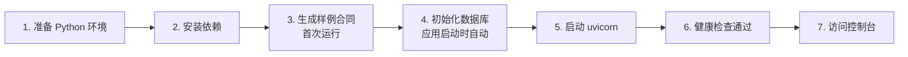

# 衡鉴 · 部署与运维规范

> **一句话结论**：系统**零外部服务依赖**（不需要 MySQL / Redis / 消息队列），
> 三种部署形态（本机一键 / Docker / 服务器 systemd）任选其一即可上线；
> 唯一的部署陷阱是 **Nginx 缓冲会把 SSE 进度事件积压**，必须在代理层显式关闭。

| 项 | 值 |
| --- | --- |
| 应用端口 | 8130（本地与服务器一致） |
| 数据落盘 | SQLite 单文件（默认 `backend/data/hengjian.db`） |
| 运行期依赖 | Python 3.11+ 与 6 个 pip 包（Docker 镜像已内置） |
| 健康检查 | `GET /api/system/health` |
| 交付形态 | 本机 `start.bat` / Docker Compose / systemd 服务 |

---

## 一、环境变量清单

全部变量在 `app/config.py` 集中定义，可通过 `.env` 覆盖（`.env.example` 可直接复制）。

### 1.1 服务

| 变量 | 默认 | 说明 |
| --- | --- | --- |
| `HJ_HOST` | `127.0.0.1` | 监听地址；容器/服务器需设为 `0.0.0.0` |
| `HJ_PORT` | `8130` | 监听端口 |
| `HJ_ROLE` | `full` | `full` = 完整模式；`demo` = 演示只读模式（放宽 CORS，便于扫码访问） |
| `HJ_DB` | `<backend>/data/hengjian.db` | SQLite 路径；容器中建议指到数据卷 `/data/hengjian.db` |

### 1.2 大模型（可留空）

| 变量 | 默认 | 说明 |
| --- | --- | --- |
| `HJ_LLM_ENABLED` | `1` | 总开关 |
| `HJ_LLM_BASE_URL` | `https://api.deepseek.com/v1` | OpenAI 兼容地址（通义 / 本地 Ollama 均可） |
| `HJ_LLM_API_KEY` | 空 | **留空即自动降级为模板生成器**，功能完整 |
| `HJ_LLM_MODEL` | `deepseek-chat` | 模型名 |
| `HJ_LLM_TIMEOUT` | `8` | 秒；超过即降级，不等模型 |
| `HJ_LLM_MAX_RETRY` | `1` | 失败重试次数（重试完仍失败即降级） |
| `HJ_LLM_TEMPERATURE` | `0` | 判定相关场景固定为 0，减少随机性 |
| `HJ_LLM_MAX_TOKENS` | `1600` | 单次输出上限 |

### 1.3 解析

| 变量 | 默认 | 说明 |
| --- | --- | --- |
| `HJ_OCR_ENABLED` | `1` | 是否允许对图片型 PDF 走 OCR |
| `HJ_OCR_MIN_CONFIDENCE` | `0.60` | 低于此值在审查意见中附质量提示（不阻塞） |
| `HJ_OCR_BLOCK_THRESHOLD` | `0.35` | **低于此值直接判 blocked**（正文不可用） |
| `HJ_MIN_TEXT_CHARS` | `120` | 解析后低于此字数视为空文 → blocked |
| `HJ_MAX_UPLOAD_MB` | `30` | 单文件上限 |

### 1.4 规则与回写

| 变量 | 默认 | 说明 |
| --- | --- | --- |
| `HJ_RULE_FILE` | `app/rules/rules_v1.yaml` | 规则库路径 |
| `HJ_TEMPLATE_FILE` | `app/rules/clause_templates.yaml` | 示范条款库路径 |
| `HJ_WRITEBACK_DRY_RUN` | `0` | **设为 `1` 时全局预览模式：只生成意见，绝不写入审批系统**（彩排建议开启） |
| `HJ_APPROVAL_SIM_BASE` | 空 | 空 = 用内置模拟器；填真实地址需同时实现 `writeback._submit_to_platform` |

### 1.5 交付信息

`HJ_TEAM`（团队名）、`HJ_OWNER`（交付人，默认"李奕波"）。

---

## 二、三种部署形态

### 2.1 形态一：本机一键启动（演示首选）

```bat
双击 start.bat
```

脚本流程：检查 uv → 创建 `.venv` → 同步依赖 → 首次运行生成样例合同 → 启动 uvicorn → 打开浏览器。

**特点**：断网可完整运行（除 LLM 增强外），无需 Docker、无需管理员权限。
**适用**：本地演示、评审彩排、开发调试。

手动等价命令：

```bash
uv venv --python 3.11 .venv
uv pip install --python .venv/Scripts/python.exe -e .
uv pip install --python .venv/Scripts/python.exe rapidocr-onnxruntime   # 可选
cd backend && python tools/gen_samples.py
cd backend && ..\.venv\Scripts\python.exe -m uvicorn app.main:app --host 127.0.0.1 --port 8130
```

### 2.2 形态二：Docker Compose（推荐用于交付评审环境）

```bash
cd deploy
docker compose up -d --build            # 仅应用，端口 8130
docker compose --profile proxy up -d     # 额外起 Nginx，端口 8080 → 8130
docker compose logs -f hengjian
docker compose down                      # 停止（数据卷 hengjian-data 保留）
```

**镜像设计**：多阶段构建 —— builder 阶段装依赖（含 build-essential），
runtime 阶段只拷 `/opt/venv` 与源码，**最终镜像不含编译工具链**。

**容器内配置要点**：

| 项 | 值 | 原因 |
| --- | --- | --- |
| `HJ_HOST` | `0.0.0.0` | 否则宿主机无法访问 |
| `HJ_DB` | `/data/hengjian.db` | 挂到命名卷，避免容器重建丢数据 |
| 样例目录 | 只读挂载 `../backend/samples` | 镜像已内置，挂载便于替换 |
| 健康检查 | `curl -fsS /api/system/health`，间隔 30s，启动宽限 30s | 首次启动要建表 + 生成样例，给足时间 |

### 2.3 形态三：服务器 systemd（长期运行）

```ini
# /etc/systemd/system/hengjian.service
[Unit]
Description=HengJian Contract Review Agent
After=network.target

[Service]
Type=simple
WorkingDirectory=/opt/hengjian/backend
Environment="HJ_HOST=0.0.0.0"
Environment="HJ_PORT=8130"
Environment="HJ_DB=/opt/hengjian/backend/data/hengjian.db"
# 密钥不要写进 unit 文件，放 EnvironmentFile 并 chmod 600
EnvironmentFile=-/opt/hengjian/.env
ExecStart=/opt/hengjian/.venv/bin/python -m uvicorn app.main:app --host 0.0.0.0 --port 8130
Restart=always
RestartSec=5
User=root

[Install]
WantedBy=multi-user.target
```

```bash
systemctl daemon-reload
systemctl enable --now hengjian
systemctl status hengjian
journalctl -u hengjian -f        # 看日志
curl -s http://127.0.0.1:8130/api/system/health | python -m json.tool
```

**部署目标（本项目规划）**：`39.96.200.45:8130`，并复用既有 BossPortal(8000) 跨端口 SSO。
**当前状态：【待部署】** —— 代码已就绪，服务器端口与 SSO 接入需现场执行。

---

## 三、启动顺序



| 序 | 步骤 | 依赖 | 校验 |
| --- | --- | --- | --- |
| 1 | 建 venv 装依赖 | Python 3.11+ | `python -c "import fastapi, yaml, docx, fitz, PIL"` |
| 2 | 生成样例与黄金标注 | python-docx / PyMuPDF / pillow | `samples/` 下出现 13 个文件 |
| 3 | 启动服务 | 上两步 | `GET /api/system/health` 返回 `status=ok` |
| 4 | （可选）配 LLM | 网络 + API Key | health 中 `llm.configured=true` |
| 5 | （可选）装 OCR | 网络 | health 中 `ocr.available=true` |

> 步骤 2 **必须在首次启动前完成**：`pull` 接口依赖 `samples/` 目录；
> 容器镜像的 CMD 里已经内置了"若样例缺失则自动生成"，因此 Docker 部署无此顾虑。

---

## 四、Nginx 反向代理（关键配置）

```nginx
location /api/contracts/ {
    proxy_pass http://hengjian_backend;
    proxy_http_version 1.1;
    proxy_set_header Host $host;

    proxy_buffering off;        # ★ SSE 必需。开着会把事件积压到连接结束才吐
    proxy_cache off;
    proxy_read_timeout 300s;
    proxy_send_timeout 300s;
    chunked_transfer_encoding on;
}
```

**如果不配 `proxy_buffering off` 会怎样**：
前端进度条在整个审查过程中一直停在 0%，直到流水线跑完才一次性跳到 100%。
这不是"慢"，而是事件被代理层缓存了 —— 而且现象看起来像后端卡住，很难联想过去。

---

## 五、日常运维

### 5.1 健康巡检

```bash
curl -s http://127.0.0.1:8130/api/system/health | python -m json.tool
```

需要关注的字段：

| 字段 | 正常值 | 异常时的含义与处置 |
| --- | --- | --- |
| `status` | `ok` | 非 ok → 进程或数据库异常 |
| `llm.configured` | `true`/`false` 均可 | `false` 只是未配置，**不是故障** |
| `ocr.available` | `true` | `false` → 扫描件会全部 blocked，装 `rapidocr-onnxruntime` |
| `rules.total` | ≥ 30 | 明显偏小 → 规则文件被改坏 |
| `db` | 可写路径 | 路径不存在 → 检查数据卷挂载与权限 |

### 5.2 日常命令

| 目的 | 命令 |
| --- | --- |
| 看服务状态 | `systemctl status hengjian` / `docker compose ps` |
| 看日志 | `journalctl -u hengjian -f` / `docker compose logs -f hengjian` |
| 跑接口冒烟 | `python tools/smoke_api.py` |
| 跑回归评测 | `python -m app.eval.run_eval` |
| 跑单元测试 | `python -m pytest -q` |
| 一键端到端演示 | `python demo.py --fresh` |
| 查看全局审计 | `curl "http://127.0.0.1:8130/api/system/audit?limit=50"` |

### 5.3 备份与恢复

| 对象 | 方式 |
| --- | --- |
| 数据库 | 停止服务后直接复制 `data/hengjian.db`（含 WAL：一并复制 `-wal` / `-shm`）；或 `sqlite3 hengjian.db ".backup 'backup.db'"` |
| 上传附件与报告 | 复制 `data/uploads/` 与 `data/reports/` |
| 规则库 | 复制 `app/rules/*.yaml`（**改动前务必先 git commit**） |
| 建议节奏 | 每次规则库变更前 + 每次演示前 |

**恢复**：把文件放回原路径 → 重启服务 → 访问 `/api/stats/overview` 核对任务数与风险命中数。

### 5.4 日志与留痕

系统**不写文件日志**，而是把结构化留痕写进数据库 `audit_logs` 表（step / tool / 输入摘要 / 输出摘要 / 耗时 / 详情）。
这样做的理由：日志与业务数据同源、可用 SQL 直接查询、导出审查报告时可一并附上处理链路。
进程级日志仍走 stdout，由 systemd / Docker 收集。

---

## 六、异常排查手册

| # | 症状 | 可能原因 | 排查与处置 |
| --- | --- | --- | --- |
| 1 | 访问 `/` 返回 404 或空白 | 前端目录缺失或挂载顺序错误 | `curl -I http://127.0.0.1:8130/`；确认 `frontend/` 与 `backend/` 同级；静态挂载必须在所有 `/api` 路由之后 |
| 2 | 进度条一直不动后瞬间跳满 | Nginx 缓冲 SSE | 在 `/api/contracts/` location 加 `proxy_buffering off` |
| 3 | 上传扫描件全部 `blocked`，代码 `OCR_ENGINE_UNAVAILABLE` | 未装 OCR 引擎 | `uv pip install rapidocr-onnxruntime`；确认 `/api/system/health` 的 `ocr.available=true` |
| 4 | 上传加密 PDF 永远 `blocked` | 设计如此 | 上传去除密码的版本；`DOC_ENCRYPTED` 不是缺陷 |
| 5 | `PIPELINE_ERROR` | 流水线内部异常 | `curl ".../api/contracts/{id}/audit"` 看 `level=error` 那条的 `detail`（含 traceback 片段） |
| 6 | `UNIQUE constraint failed: contracts.idem_key` | 任务编号生成重复（理论上已通过随机后缀避免） | 检查 `gen_code()` 是否被改动；历史数据冲突可手工清理该 `idem_key` |
| 7 | 回写返回 409 | 任务未 `completed`，或审查结果被人工驳回 | `GET .../hitl` 看 `available_actions`；被驳回需重跑流水线 |
| 8 | 报告 PDF 中文乱码 | PyMuPDF 版本过旧 | 升级 `pymupdf`；或先导出 Markdown 兜底 |
| 9 | 大模型一直走模板路径 | Key 为空 / 超时 / 返回非法 JSON | 看 `reviews.generated_by`；`GET /api/system/health` 的 `llm.configured`；适度调大 `HJ_LLM_TIMEOUT` |
| 10 | 容器起来后宿主机访问不通 | `HJ_HOST` 仍为 `127.0.0.1` | 改为 `0.0.0.0` 并重建容器 |
| 11 | 容器重建后数据没了 | 数据库写在了容器内非卷路径 | 把 `HJ_DB` 指到命名卷 `/data/hengjian.db` |
| 12 | `pytest` 报编码错乱 | 控制台编码与 UTF-8 冲突 | 设 `PYTHONIOENCODING=utf-8`；输出重定向用 `\| Out-File -Encoding utf8` |
| 13 | 直连 PyPI 装包超时 / TLS EOF | 网络受限 | `uv pip install --index-url https://mirrors.aliyun.com/pypi/simple/ <pkg>` |
| 14 | 从脚本启动的服务很快退出 | 受限环境回收子进程 | 长期驻留的服务请用 systemd / Docker 托管，不要用脚本前台拉起 |

---

## 七、性能与容量

| 指标 | 实测值 | 说明 |
| --- | --- | --- |
| 解析 + 条款切分 | **≈700 ms / 份**（平均，13 份样例） | 含 DOCX / PDF / OCR 三类 |
| 规则引擎判定 | **1 ms / 份**（32 条规则全跑） | 纯内存计算 |
| LLM 语义增强 | ≤ 8 s（超时即降级） | 可用 `HJ_LLM_TIMEOUT` 调 |
| 报告导出 | PDF 约 50–60 KB / 份 | 与内容长度相关 |
| 并发模型 | uvicorn 单进程 + 后台线程跑流水线 + 进程内 EventBus | **不支持多进程横向扩展**（EventBus 在进程内） |

**扩容路径【未开发】**：若需多进程/多实例，EventBus 需替换为 Redis Pub/Sub 或消息队列，
并把任务状态机改为基于数据库的抢占式调度。当前单机形态足以支撑单部门日常审查量。

---

## 八、安全检查清单（上线前）

| # | 检查项 | 当前状态 |
| --- | --- | --- |
| 1 | 是否暴露公网 | ⚠️ 需经网关 + SSO，不可直接开放 8130 |
| 2 | 是否有鉴权 | ❌ **【未开发】** —— 上线前必须补 |
| 3 | 上传文件是否做类型与大小校验 | ✅ 扩展名白名单 + 30MB 上限 |
| 4 | 是否有路径穿越风险 | ✅ 文件按 SHA256 命名落盘，不使用用户提供的文件名做路径 |
| 5 | SQL 是否参数化 | ✅ 全部使用占位符，无字符串拼接 |
| 6 | API Key 是否入库/入日志 | ✅ 仅在环境变量，不落库；审计只记摘要哈希 |
| 7 | 是否记录敏感原文 | ⚠️ `audit_logs` 会记录 `input_digest`（哈希）而非原文；但 `findings.evidence_text` 会存证据原文片段（业务必需） |
| 8 | 回写是否可误触发 | ✅ 需任务 `completed` 且未被驳回；默认 `dry_run` |

---

## 相关文档

- `docs/12_release_deployment/项目环境要求.md` —— 软硬件与依赖清单
- `docs/13_delivery/设备手册.md` —— 面向操作者的使用说明
- `docs/13_delivery/可交付运行产物.md` —— 交付包内容与启动方式
- `deploy/` —— Dockerfile / docker-compose.yml / nginx 配置（真实文件）
